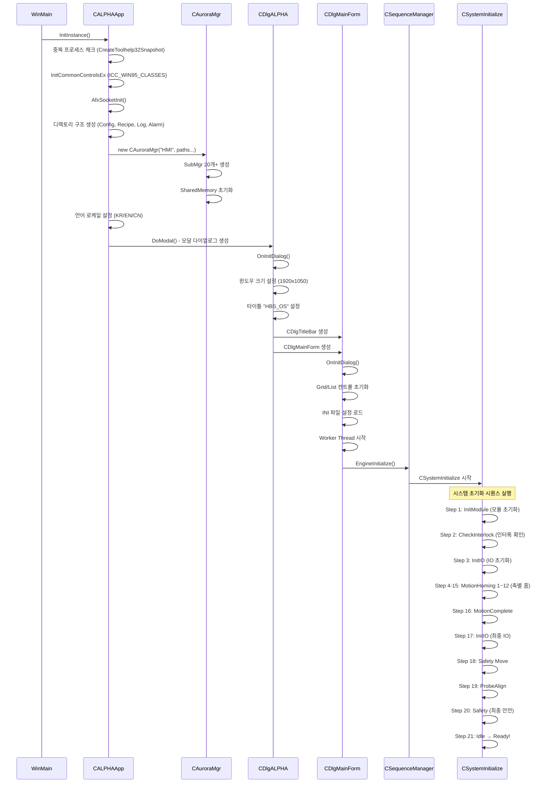
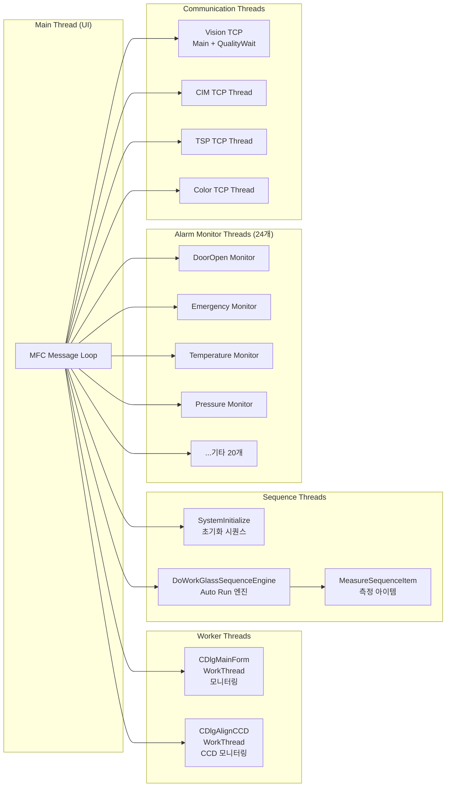
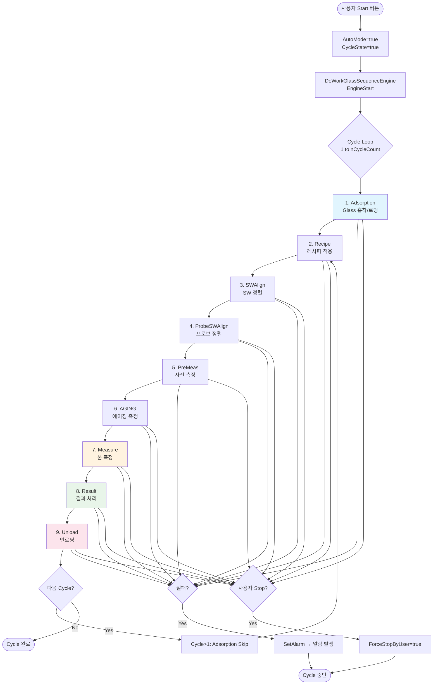
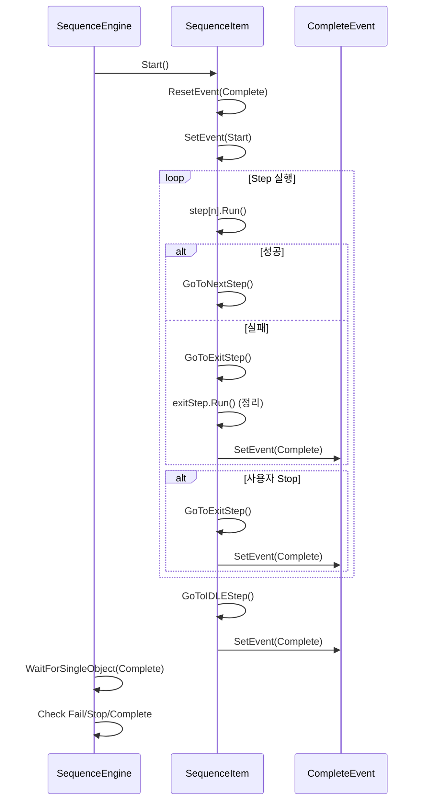
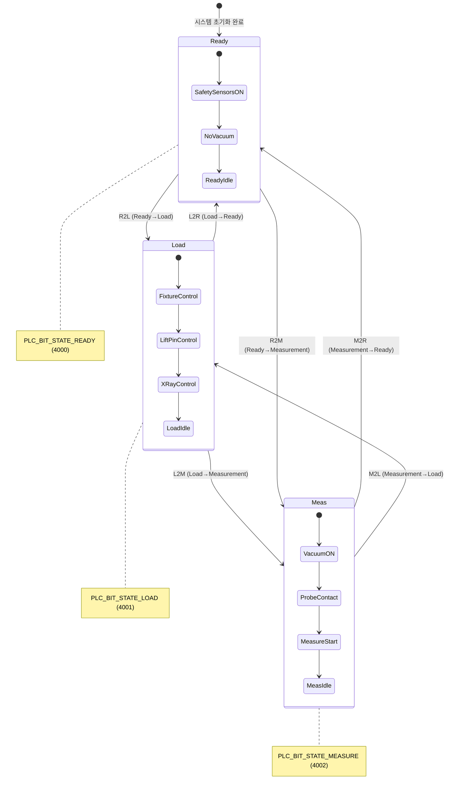
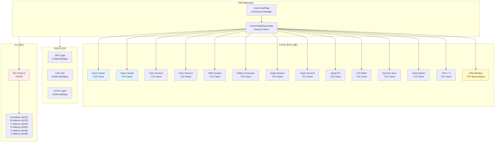
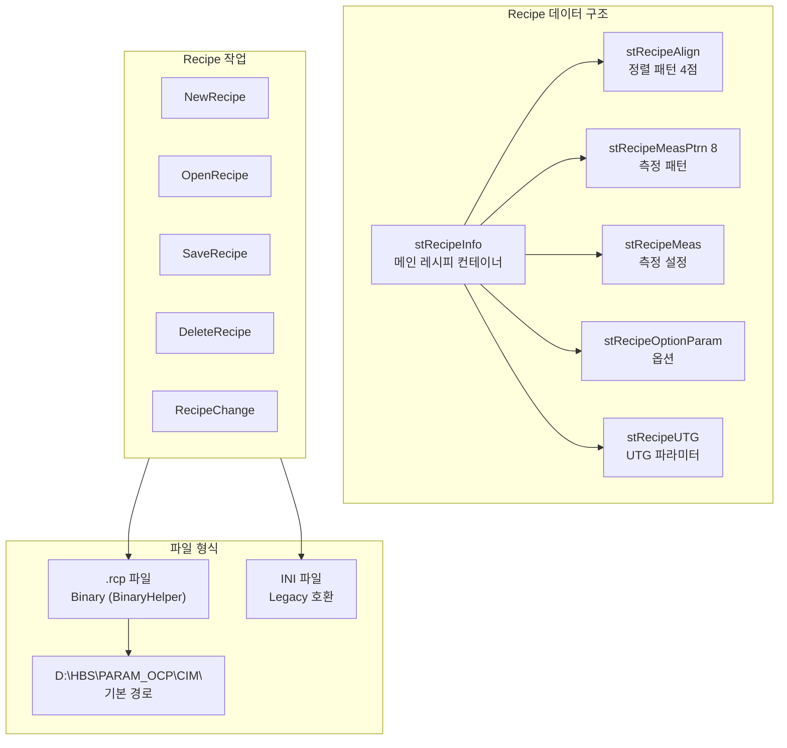

# ALPHA HMI 자동화 설비 제어 소프트웨어 전체 분석서

> **분석일:** 2026-05-22  
> **프로젝트:** D:\OCP\HMI\HMI (1)\Source\ALPHA\ALPHA.sln  
> **환경:** Visual Studio 2019, C++ MFC, Unicode, Win32/x64  
> **용도:** Glass 검사 자동화 설비 HMI (Samsung 디스플레이 검사 장비)

---

## 목차

1. [전체 시스템 구조도](#1-전체-시스템-구조도)
2. [프로젝트 폴더 및 파일 구조](#2-프로젝트-폴더-및-파일-구조)
3. [주요 클래스 및 역할](#3-주요-클래스-및-역할)
4. [초기화 순서 분석](#4-초기화-순서-분석)
5. [Thread 구조 분석](#5-thread-구조-분석)
6. [설비 동작 Flow 분석](#6-설비-동작-flow-분석)
7. [통신 구조 분석](#7-통신-구조-분석)
8. [데이터 구조 분석](#8-데이터-구조-분석)
9. [Alarm 처리 Flow](#9-alarm-처리-flow)
10. [문제 가능성 및 개선안](#10-문제-가능성-및-개선안)
11. [신규 개발자 파일 우선순위](#11-신규-개발자-파일-우선순위)

---

## 1. 전체 시스템 구조도

### 1.1 시스템 아키텍처 개요

```mermaid
graph TB
    subgraph Application["Application Layer"]
        APP[CALPHAApp<br/>CWinApp]
        DLG[CDlgALPHA<br/>Main Dialog]
        TITLE[CDlgTitleBar]
        MAIN[CDlgMainForm]
    end

    subgraph Manager["Manager Layer (CAuroraMgr)"]
        MGR[CAuroraMgr<br/>Central Orchestrator]
        SYS[CSystemConfigMgr]
        NET[CNetworkConfigMgr]
        POS[CPositionConfigMgr]
        IO[CIOMapControlMgr]
        MOT[CMotorControlMgr]
        RCP[CRecipeEditMgr]
        RST[CResultCollectMgr]
        ALM[CAlarmMonitorMgr]
        TCP[CCommTcpIPMgr]
        FAC[CCommTcpIpFactoryMgr]
        VIS[CVisionConfigMgr]
        CAM[CAlignCameraMgr]
        SHR[CShareMemoryMgr]
        SNS[CSensorMonitorMgr]
        LGT[CLightControlMgr]
        SEQ[CSeqTactTimeMgr]
        SEM[CSEMControlMgr]
        MNT[CMaintControlMgr]
        TRG[CTriggerControlMgr]
        LCK[CLockControlMgr]
    end

    subgraph Sequence["Sequence Engine Layer"]
        SEQM[CSequenceManager<br/>Singleton]
        INIT[CSystemInitialize]
        GLASS[CDoWorkGlassSequence]
        ENG[CDoWorkGlassSequenceEngine]
        STATE[CFunctionModuleEQState]
        STCHG[CFunctionModuleEQStateChange]
        INTLK[CFunctionModuleEQInterlock]
        CIM[CDoWorkSequenceCIM]
    end

    subgraph Communication["Communication Layer"]
        TCPV[CommTcpIpObjectVision]
        TCPC[CommTcpIpObjectColor]
        TCPM[CommTcpIpObjectMotion]
        TCPCIM[CommTcpIpObjectCIM]
        TCPTSP[CommTcpIpObjectTSP]
        TCPPG[CommTcpIpObjectPG]
        TCPWAD[CommTcpIpObjectWAD]
        SER[Serial RS232<br/>Light Control]
    end

    subgraph UI["UI Dialog Layer"]
        NAV[CDlgNaviBar]
        OPR[DlgSubOperate]
        MAN[DlgSubManual]
        REC[DlgSubRecipe]
        CFG[DlgSubConfig]
        MNT2[DlgSubMaint]
        LOG[DlgSubLog]
        DATA[DlgSubData]
        ALMD[DlgSubAlarm]
        CCD[CDlgAlignCCD]
    end

    subgraph External["External Devices"]
        PLC[PLC<br/>MC Protocol]
        MOTOR[Motion Controller<br/>ACS/COMIZOA]
        CAMERA[Basler GigE Camera]
        VISION[Vision System]
        COLOR[Color Sensor]
        WAD[WAD System]
        TSP[TSP Instrument]
        LCR[LCR Meter]
        PG[Pattern Generator]
    end

    APP --> DLG
    DLG --> TITLE
    DLG --> MAIN
    MAIN --> MGR
    MGR --> SYS & NET & POS & IO & MOT & RCP & RST
    MGR --> ALM & TCP & FAC & VIS & CAM & SHR
    MGR --> SNS & LGT & SEQ & SEM & MNT & TRG & LCK
    MGR --> SEQM
    SEQM --> INIT & GLASS & STATE & STCHG & INTLK & CIM
    GLASS --> ENG
    MAIN --> NAV
    NAV --> OPR & MAN & REC & CFG & MNT2 & LOG & DATA & ALMD
    MAIN --> CCD

    TCP --> TCPV & TCPC & TCPM & TCPCIM & TCPTSP & TCPPG & TCPWAD
    LGT --> SER

    IO --> PLC
    MOT --> MOTOR
    CAM --> CAMERA
    TCPV --> VISION
    TCPC --> COLOR
    TCPWAD --> WAD
    TCPTSP --> TSP
    TCPPG --> PG
```



### 1.2 모듈 관계 요약

| 계층 | 모듈 | 역할 |
|------|------|------|
| **Application** | CALPHAApp, CDlgALPHA | MFC 앱 진입점, 메인 다이얼로그 |
| **Manager** | CAuroraMgr + 20+ SubMgr | 전체 시스템 리소스 중앙 관리 |
| **Sequence** | CSequenceManager + Engine | Auto/Init/State 시퀀스 실행 |
| **Communication** | CommTcpIp* + Serial | 외부 장비 TCP/IP 및 RS232 통신 |
| **UI** | DlgSub* + CDlgAlignCCD | 사용자 인터페이스 (네비게이션 기반) |
| **External** | PLC, Motor, Vision, Camera | 실제 하드웨어 장비 |

---

## 2. 프로젝트 폴더 및 파일 구조

```
D:\OCP\HMI\HMI (1)\Source\ALPHA\
│
├── ALPHA.sln                          # 솔루션 파일
├── ALPHA.vcxproj                      # 프로젝트 파일 (v142, MFC Dynamic)
│
├── ALPHA.h / ALPHA.cpp                # CALPHAApp (CWinApp)
├── DlgALPHA.h / DlgALPHA.cpp         # CDlgALPHA (메인 다이얼로그)
├── AuroraMgr.h / AuroraMgr.cpp       # CAuroraMgr (중앙 매니저)
├── DlgMainForm.h / DlgMainForm.cpp   # CDlgMainForm (메인 폼)
├── DlgTitleBar.h / DlgTitleBar.cpp   # CDlgTitleBar (타이틀 바)
├── DlgNaviBar.h / DlgNaviBar.cpp     # CDlgNaviBar (네비게이션 바)
│
├── SystemParamShare.h / .cpp          # 전역 파라미터 (Singleton)
├── CommTcpIpDefine.h                  # TCP/IP 통신 상수 정의
├── AuroraFuncDefine.h                 # 전체 Enum/Macro 정의
│
├── Alarm/                             # Alarm 시스템 (30+ 파일)
│   ├── AlarmController.h/cpp          # 알람 컨트롤러 (Singleton)
│   ├── AlarmMonitorMgr.h/cpp          # 알람 모니터 매니저
│   ├── AlarmMonitorImpl.h/cpp         # 알람 모니터 베이스
│   └── AlarmMonitorTo*.h/cpp          # 24개 개별 알람 모니터 스레드
│
├── DoWork/                            # 시퀀스 엔진 (40+ 파일)
│   ├── BaseSequenceImpl.h/cpp         # 시퀀스 베이스 (스레딩)
│   ├── BaseSequenceBody.h             # 시퀀스 베이스 바디
│   ├── SequenceManager.h/cpp          # 시퀀스 매니저 (Singleton)
│   ├── SystemInitialize.h/cpp         # 시스템 초기화 시퀀스
│   ├── DoWorkGlassSequence.h/cpp      # Glass 시퀀스 래퍼
│   ├── DoWorkGlassSequenceEngine.h/cpp # Glass 시퀀스 엔진 (핵심)
│   ├── DoWorkGlassSequenceImpl.h/cpp  # Glass 시퀀스 아이템 구현
│   ├── DoWorkGlass*.h/cpp             # 개별 공정 단계들
│   │   ├── DoWorkGlassAdsorption      # 흡착/로딩
│   │   ├── DoWorkGlassRecipe          # 레시피 적용
│   │   ├── DoWorkGlassSWAlign         # SW 정렬
│   │   ├── DoWorkGlassPreMeas         # 사전 측정
│   │   ├── DoWorkGlassAGING           # 에이징
│   │   ├── DoWorkGlassMeasure         # 측정
│   │   ├── DoWorkGlassResult          # 결과 처리
│   │   ├── DoWorkGlassUnload          # 언로딩
│   │   └── DoWorkGlassUnloading       # 언로딩 상세
│   └── MeasureSequenceItem*.h/cpp     # 측정 시퀀스 아이템
│
├── FunctionModule/                    # 기능 모듈 (10+ 파일)
│   ├── FunctionModuleEQState.h/cpp    # 설비 상태 관리
│   ├── FunctionModuleEQStateChange.h/cpp # 상태 전이
│   ├── FunctionModuleEQInterlock.h/cpp   # 인터록
│   ├── FunctionModuleProbeACC.h/cpp   # 프로브 ACC
│   ├── FunctionModuleAutoFocus.h/cpp  # 오토 포커스
│   ├── FunctionModuleCentering.h/cpp  # 센터링
│   └── FunctionModuleAFControl.h/cpp  # AF 제어
│
├── Manager/                           # 매니저 클래스 (40+ 파일)
│   ├── SystemConfigMgr.h/cpp          # 시스템 설정
│   ├── NetworkConfigMgr.h/cpp         # 네트워크 설정
│   ├── PositionConfigMgr.h/cpp        # 포지션 설정
│   ├── IOMapControlMgr.h/cpp          # IO맵 제어
│   ├── MotorControlMgr.h/cpp          # 모터 제어
│   ├── CommTcpIPMgr.h/cpp             # TCP/IP 매니저
│   ├── CommTcpIpFactoryMgr.h/cpp      # TCP/IP 팩토리 (26K줄)
│   ├── ShareMemoryMgr.h/cpp           # 공유 메모리
│   ├── AlignCameraMgr.h/cpp           # 정렬 카메라
│   └── ...기타 매니저 클래스
│
├── Recipe/                            # 레시피 관리 (5 파일)
│   ├── RecipeData.h/cpp               # 레시피 데이터 구조
│   ├── RecipeEditMgr.h/cpp            # 레시피 편집기
│   └── RecipeMgr.h/cpp                # 레시피 매니저
│
├── CommTcpIpObject*.h/cpp             # 장비별 TCP/IP 통신 (20+ 파일)
│
├── DlgSub*.h/cpp                      # 서브 다이얼로그 (UI)
│
├── ConfigurationFile/                 # 설정 파일
│   ├── CoreFunction/
│   │   ├── AlarmConfig/               # 알람 메시지 CSV
│   │   ├── IOMapConfig/               # IO맵 CSV (D,F,M,C,P,G 등)
│   │   └── MotorConfig/               # 모터 설정
│   └── Recipe/                        # 레시피 파일
│       └── ALIGN_RECIPE/              # 정렬 레시피
│
└── res/                               # 리소스 파일
    ├── Bitmap/
    ├── Navigator/
    └── Warning/
```

### 외부 라이브러리 의존성

| 라이브러리 | 용도 |
|-----------|------|
| olch2du8.lib | 차트/그래프 컨트롤 |
| Alarm.lib | 알람 시스템 |
| dMCCSpec.lib | MCC (Motion Control) |
| dSACC.lib | SACC 제어 |
| ProbeHistory.lib | 프로브 이력 관리 |
| dResult.lib | 결과 데이터 처리 |
| dfcRecipe64.lib | 64비트 레시피 처리 |

---

## 3. 주요 클래스 및 역할

### 3.1 핵심 클래스 설명

#### **CALPHAApp** (ALPHA.cpp)
- MFC 애플리케이션 진입점 (`CWinApp` 상속)
- 중복 실행 방지, 소켓 초기화, 디렉토리 생성
- `CAuroraMgr` 인스턴스 생성 및 관리

#### **CAuroraMgr** (AuroraMgr.cpp)
- **중앙 오케스트레이터**: 모든 SubMgr를 생성/관리
- 20개 이상의 SubMgr에 대한 Getter 메서드 제공
- 서브 다이얼로그 등록/관리 (`PushSubDlg`, `ChangeDlgView`)
- Notify 패턴으로 이벤트 전파

#### **CSequenceManager** (SequenceManager.cpp) - Singleton
- Auto Run, Init, State Change 시퀀스 총괄
- `EngineStart/Stop/Pause/Resume` 인터페이스
- 모든 시퀀스 아이템 생성 및 라이프사이클 관리

#### **CSystemParamShare** (SystemParamShare.cpp) - Singleton
- 전역 상태 변수 관리 (Auto/Manual, CycleState, TestMode)
- Glass/Cell/Lot/Recipe ID 등 공정 정보
- 경로 정보 (App, Config, Log, Recipe, Result, Alarm)

#### **CAlarmController** (AlarmController.cpp) - Singleton
- 알람 발생/해제/조회 통합 관리
- CSV 기반 알람 메시지 로드

### 3.2 클래스 상속 구조

```mermaid
classDiagram
    CWinApp <|-- CALPHAApp
    CDialogEx <|-- CDlgALPHA
    CD_AuroraDlgWin <|-- CDlgMainForm
    
    CAuroraSubMgr <|-- CSystemConfigMgr
    CAuroraSubMgr <|-- CNetworkConfigMgr
    CAuroraSubMgr <|-- CIOMapControlMgr
    CAuroraSubMgr <|-- CMotorControlMgr
    CAuroraSubMgr <|-- CCommTcpIPMgr
    CAuroraSubMgr <|-- CAlarmMonitorMgr
    CAuroraSubMgr <|-- CShareMemoryMgr
    CAuroraSubMgr <|-- CRecipeEditMgr
    CAuroraSubMgr <|-- CVisionConfigMgr
    
    CBaseSequenceBody <|-- CBaseSequenceImpl
    CBaseSequenceImpl <|-- CSystemInitialize
    CBaseSequenceImpl <|-- CDoWorkGlassSequence
    
    CCommEthFunction <|-- CCommTcpIpObjectVision
    CCommEthFunction <|-- CCommTcpIpObjectColor
    CCommEthFunction <|-- CCommTcpIpObjectMotion
    CCommEthFunction <|-- CCommTcpIpObjectCIM
    CCommEthFunction <|-- CCommTcpIpObjectTSP
    CCommEthFunction <|-- CCommTcpIpObjectWAD
    
    CAlarmMonitorImpl <|-- CAlarmMonitorToDoorOpenState
    CAlarmMonitorImpl <|-- CAlarmMonitorToEmergencyButton
    CAlarmMonitorImpl <|-- CAlarmMonitorToSensorTemperature
    CAlarmMonitorImpl <|-- CAlarmMonitorToSafetyPLC
```



---

## 4. 초기화 순서 분석

### 4.1 애플리케이션 시작 시퀀스



### 4.2 Homing 시퀀스 상세

| Step | 대상 | 설명 |
|------|------|------|
| 4 | Z축 | Z축 우선 홈 (충돌 방지) |
| 5 | Cross (Gantry) | 갠트리 홈 |
| 6 | Probe Unit | 프로브 유닛 홈 |
| 7 | Stage | 스테이지 홈 |
| 8 | AC (Auto-Change) | 자동교환장치 홈 |
| 9-15 | 추가 다축 | 부가 축 순차 홈 |

---

## 5. Thread 구조 분석

### 5.1 스레드 아키텍처 개요



### 5.2 스레딩 패턴

**공통 패턴:** `AfxBeginThread(ThreadRun, this)` + 이벤트 동기화

```cpp
// 기본 패턴
CWinThread* m_pThread;
HANDLE m_hStartEvent;    // 시작 신호
HANDLE m_hCloseEvent;    // 종료 신호
HANDLE m_hCompleteEvent; // 완료 신호

static UINT ThreadRun(LPVOID p1) {
    CBaseSequenceImpl* pThis = (CBaseSequenceImpl*)p1;
    while (WaitForSingleObject(pThis->m_hCloseEvent, 0) != WAIT_OBJECT_0) {
        WaitForSingleObject(pThis->m_hStartEvent, INFINITE);
        // 시퀀스 실행
        SetEvent(pThis->m_hCompleteEvent);
    }
    return 0;
}
```

### 5.3 동시 스레드 수 추정

| 분류 | 수량 | 비고 |
|------|------|------|
| UI Main Thread | 1 | MFC 메시지 루프 |
| Worker Threads | 2-3 | MainForm, AlignCCD |
| Sequence Threads | 2-5 | Init, AutoRun, Measure |
| Alarm Monitor Threads | 24 | 센서별 개별 스레드 |
| Communication Threads | 5-8 | Vision(2), CIM, TSP, Color 등 |
| **합계** | **34~41** | 피크 시 50+ 가능 |

---

## 6. 설비 동작 Flow 분석

### 6.1 Auto Run Sequence



### 6.2 개별 시퀀스 아이템 실행 패턴



### 6.3 State Machine 구조



### 6.4 Equipment State 전이 상세

| 전이 코드 | 방향 | 주요 단계 |
|-----------|------|----------|
| R2L (1) | Ready→Load | Meas상태→LoaderXYRLoad→Ready→FixtureUp→X-Ray ON→LPUp→FixtureDown→Load |
| L2M (2) | Load→Meas | X-Ray ON→FixtureUpBack→LPDown→X-Ray OFF→FixtureDown→Meas→LoaderXYRMeas |
| M2R (3) | Meas→Ready | (역방향 M2R 단계) |
| R2M (4) | Ready→Meas | (직접 전이) |
| M2L (5) | Meas→Load | (역방향 M2L 단계) |
| L2R (6) | Load→Ready | (역방향 L2R 단계) |
| SAFETY (7) | Safety Move | 안전 이동 |

### 6.5 Interlock 구조

```mermaid
graph TD
    subgraph MotionInterlock["Motion Interlock"]
        MX[MoveX<br/>LDX Loading + LDZ Loading + Clamp]
        MY[MoveY<br/>LDX Loading + LDZ Loading + Clamp]
        MZ[MoveZ<br/>LDX Loading + LDZ Loading + Clamp]
        MLX[MoveLDX<br/>Stage Safe + Head Safe + LDZ + LP Up]
        MLY[MoveLDY<br/>Stage Safe + Head Safe + LDZ]
        MLR[MoveLDR<br/>Stage Safe + Head Safe + LDZ]
        MLZ[MoveLDZ<br/>Stage Safe + Head Safe + Contact]
    end

    subgraph IOInterlock["IO Interlock"]
        ILP[IO LiftPin<br/>Stage+Head Safe + LDX + LDZ]
        ICL[IO Clamp<br/>Stage+Head + LDX Contact + LDZ]
        IVA[IO Vacuum<br/>Stage+Head + LDX/Z + LP + Clamp Unfold]
        IAR[IO Air<br/>Same as Vacuum]
    end

    subgraph SafetySensors["Safety Sensors"]
        SS[IsStageSafety<br/>Unload Sensor03]
        HS[IsHeadSafety<br/>Unload Sensor01-02 Gantry]
        LX[IsLDXLoading<br/>Loader X Position]
        LZ[IsLDZLoading<br/>Loader Z Position]
        LP[IsLPUp<br/>Lift Pins All Up]
        CF[IsClampFold<br/>Clamps Folded]
        GE[IsGlassExist<br/>Glass Presence]
    end

    SS --> MX & MY & MZ & MLX & ILP & ICL & IVA
    HS --> MLX & MLY & MLZ & ILP & ICL & IVA
    LX --> MX & MY & MZ & MLX & ILP
    LZ --> MX & MY & MZ & MLZ & ILP & ICL
    LP --> MLX & IVA
    CF --> MX & IVA
```



### 6.6 Auto/Manual 전환 로직

```cpp
// SystemParamShare (Singleton)
void SetAutoMode(bool bAutoMode);   // 모드 전환
bool IsAutoMode();                   // 현재 모드 조회
void SetCycleState(bool bState);     // Cycle 상태 설정
bool IsCycleState();                 // Cycle 실행 중 여부
bool m_bForceStopByUser;             // 사용자 강제 중지
```

**Manual 동작 모드:**

| Enum | 모드 | 다이얼로그 |
|------|------|-----------|
| 0 | MEAS | CDlgSubManual_Meas - 수동 측정 |
| 1 | IONIZER | CDlgSubManual_Ionizer - 이오나이저 |
| 2 | AGINGTEST | CDlgSubManual_AgingTest - 에이징 테스트 |
| 3 | AGINGSET | CDlgSubManual_AgingSet - 에이징 설정 |
| 4 | AUTOCONTACT | CDlgSubManual_AutoContact - 자동 접촉 |
| 5 | SACC | CDlgSubManual_STEP - SACC 동작 |

---

## 7. 통신 구조 분석

### 7.1 전체 통신 아키텍처



### 7.2 PLC 통신 방식

**프로토콜:** MC Protocol (Mitsubishi) over TCP/IP

| 주소 영역 | IP | Port | 용도 |
|-----------|----|----|------|
| M Address | 192.168.0.101 | 8192 | 모터 제어 비트 |
| W Address | 192.168.0.101 | 8193 | 모터 쓰기 워드 |
| F Address | 192.168.0.101 | 8194 | 기능 비트 |
| D Address | 192.168.0.101 | 8195 | 데이터 워드 |
| P Address | 192.168.0.101 | 8195 | PACC 파라미터 |
| C Address | 192.168.0.101 | 8196 | 프로브 카드 |

**주요 PLC 비트 맵핑:**

```
상태 비트:
  4000 - STATE_READY        4001 - STATE_LOAD
  4002 - STATE_MEASURE      4008 - STATE_ALARM
  4009 - STATE_WARN

제어 비트:
  4500 - INITIALIZE          4005 - INITIALIZE_COMPLETE
  4501 - READY2LOAD_START    4502 - LOAD2MEAS_START
  4503 - MEAS2READY_START    4504 - READY2MEAS_START
  4505 - MEAS2LOAD_START     4506 - LOAD2READY_START

출력 비트:
  4920 - EQ_BUZZER
  4930 - TOWER_RED           4931 - TOWER_YELLOW
  4932 - TOWER_GREEN         4925 - TOWER_BUZZER
```

**IO맵 설정 파일 (CSV):**
- D.csv, F.csv, M.csv, C.csv, P.csv, G.csv
- SACC.csv, GlassSensor.csv, ProbeCard.csv
- PLC_LOAD.csv, PLC_MEAS.csv, PLC_READY.csv

### 7.3 Motion 제어 구조

**지원 디바이스:** ACS (기본), COMIZOA, PMAC, MEI

```
구성: CoreFunction.ini → [MOTOR_CONTROL_MGR]
  DEVICE_TYPE = ACS
  ADDRESS = 10.0.0.100
  PORT = 701
  INTERLOCKPOS = 1200
  INTERLOCKGANGAP = 344
  INTERLOCKHEADGAP = 514
```

**축 정의:**
| Enum | 축 | 용도 |
|------|---|------|
| 0 | X | X축 이동 |
| 1 | Y | Y축 이동 |
| 2 | R | 회전축 |

**주요 명령:**
```cpp
MoveHome(iAxis)                          // 홈 이동
MoveCmdPosA(iAxis, dPos, bBlock, iSpeed) // 절대 위치 이동
MoveCmdPosR(iAxis, dPos, bBlock, iSpeed) // 상대 위치 이동
MoveCmdPosMulti(pPos, iAxis, iSpeed)     // 다축 동시 이동
MoveJog(iAxis, bDir)                     // Jog 이동
SetAmpEnable(iAxis, bOn)                 // 앰프 ON/OFF
```

### 7.4 Vision 인터페이스

**카메라:** Basler GigE Camera (기본)

```
지원 카메라 타입:
- CL_CAMERA_8M_NI_BOARD
- CL_CAMERA_29M_MATROX
- CL_CAMERA_SP5000C_NI_BOARD
- GIGE_CAMERA_BASLER (기본)
- GIGE_CAMERA_VIEWORKS
```

**Vision 통신 (TCP/IP):**
```cpp
SetTime_Sync()                    // 시간 동기화
RecipeChange()                    // 레시피 변경
SetParameter()                    // 파라미터 설정
InspectStart(iMeasType, bWait)    // 검사 시작
InspectEnd()                      // 검사 종료
WaitInspectionComplete(timeout)   // 결과 대기
TossResultFile(strInnerID, nArea) // 결과 파일 수신
```

**비동기 결과 처리 (Quality Wait Thread):**
```cpp
QualityWaitSet(strInnerID, nSheetRow, strCellID)  // 결과 대기열 등록
QualityWaitRun(strInnerID)                         // 결과 처리 실행
QualityBufferEmpty()                                // 버퍼 비어있는지 확인
```

### 7.5 CIM 인터페이스

```cpp
// ELP Protocol 구조체
typedef struct {
    req_head hrd;
    TCHAR szModel[32];
    int Select;        // 0x31=Left, 0x32=Right, 0x33=Both
    int Retest;        // 0x30=Normal, 0x31=Offline, 0x32=ReAvt
    TCHAR InnerID[2][32];
    TCHAR MCRID[2][32];
} ELPPROTOCOL;
```

### 7.6 TCP/IP Timeout 설정

| 상수 | 값 | 용도 |
|-----|---|------|
| RESET_INIT_WAIT_TIME | 20,000ms | 초기화 대기 |
| INSPECTION_WAIT_TIME | 30,000ms | 검사 대기 |
| PARAMETERS_WAIT_TIME | 5,000ms | 파라미터 설정 |
| RESPONSE_WAIT_TIME | 2,000ms | 응답 대기 |
| AGING_WAIT_TIME | 600,000ms | 에이징 (10분) |

### 7.7 네트워크 드라이브 매핑

| 드라이브 | 용도 |
|---------|------|
| Z:\ | Vision Head1 결과/레시피 |
| Y:\ | Vision Head2 결과/레시피 |
| X:\ | Angle Sensor 결과 |
| V:\ | PPA 네트워크 |
| W:\ | PPA 결과 (Head1/Head2) |

---

## 8. 데이터 구조 분석

### 8.1 Recipe 관리 방식



**Recipe 옵션 주요 항목:**

| 파라미터 | 기본값 | 설명 |
|---------|-------|------|
| nMeasMode | 0 (PPA) | 측정 모드 |
| nUseMeasHead | 0 (Both) | 사용 헤드 |
| dHeadGap | - | 헤드 간격 |
| dCellSizeW/H | - | 셀 크기 |
| bUseAlign | - | 정렬 사용 여부 |
| bUsePatternMatch | - | 패턴 매칭 사용 |
| bUsePPA | - | PPA 측정 사용 |
| nGlassModel | - | Glass 모델 |

### 8.2 Config 저장 구조

**CoreFunction.ini** - 하드웨어 설정
```ini
[MOTOR_CONTROL_MGR]    → 모터 컨트롤러 (ACS, IP, Port)
[IO_MAP_CONTROL_MGR]   → PLC IO맵 (MC Protocol, 다중 포트)
[ALIGN_CAMERA_MGR]     → 카메라 설정 (Basler, GigE)
[LIGHT_CONTROL_MGR_1]  → 조명1 (SPO, COM8)
[LIGHT_CONTROL_MGR_2]  → 조명2 (CAS, COM9)
[SEM_CONTROL_MGR]      → SEM 제어 (Ethernet)
```

**Config.ini** - 소프트웨어 설정
```ini
[DIR]       → 경로 설정 (ROOT, LOG, RESULT, RCP, CIM_PATH)
[MEASURE]   → 측정 옵션
[LOADERALIGN] → 로더 정렬 파라미터
[ALARM]     → 알람 활성화 설정
```

### 8.3 공유 메모리 구조 (VTM_SYSTEM)

```cpp
// ShareMemoryMgr - CCriticalSection 보호
struct VTM_SYSTEM {
    int AlarmStatus;      // 알람 상태
    int ProcessStatus;    // 공정 상태
    char UserPermit[];    // 사용자 권한
    int MachineMode;      // 기계 모드
    bool GlassJudge;      // Glass 판정
    bool AutoAgingMode;   // 자동 에이징 모드
    bool LampTimeOver[];  // 램프 타임오버
    int ProbeChange;      // 프로브 교환 상태
};
```

### 8.4 Global 변수 (SystemParamShare - Singleton)

```cpp
// 경로 정보
CString m_strAppFolderPath;
CString m_strConfigFolderPath;
CString m_strLoggerFolderPath;
CString m_strRecipeFolderPath;
CString m_strResultFolderPath;

// 시스템 상태
bool m_bInitialized;
bool m_bAutoMode;          // Auto/Manual
bool m_bForceStopByUser;   // 강제 정지
bool m_bCycleState;        // Cycle 실행 중
bool m_bTestMode;          // 테스트 모드

// Glass/공정 정보
CString m_strInnerID;      // Glass 내부 ID
CString m_strGlassID;
CString m_strCellID;
CString m_strLotID;
CString m_strRecipeID;
CString m_strStepID;
CString m_strOperID;       // 작업자 ID
int m_nCycleCount;         // Cycle 카운트
```

---

## 9. Alarm 처리 Flow

```mermaid
flowchart TD
    subgraph AlarmMonitors["24개 Alarm Monitor Threads"]
        AM1[DoorOpen Monitor]
        AM2[Emergency Monitor]
        AM3[SafetyPLC Monitor]
        AM4[Temperature Monitor]
        AM5[Pressure Monitor]
        AM6[Smoke Monitor]
        AM7[VacSwitch Monitor]
        AM8[FAN Monitor]
        AM9[HandSwitch Monitor]
        AM10[TeachKey Monitor]
        AM11[LampTime Monitor]
        AM12[McOFF Monitor]
    end

    subgraph AlarmFlow["Alarm 처리 Flow"]
        DETECT[센서 상태 감지<br/>IO 비트 폴링]
        EVAL{알람 조건<br/>충족?}
        SET[CAlarmController<br/>::SetAlarm(UINT id)]
        CSV[AlarmMessage.csv<br/>메시지 조회]
        POPUP[CD_PopUp_AlarmDlg<br/>팝업 표시]
        TOWER[Tower Lamp<br/>RED 점등]
        BUZZER[Buzzer ON]
        LOG[알람 로그 기록]
        STOP[CycleState = false<br/>시퀀스 중단]
    end

    subgraph AlarmClear["알람 해제"]
        CLEAR[ClearAlarm()]
        RESET[조건 복구 확인]
        RESUME[시퀀스 재개 가능]
    end

    AM1 & AM2 & AM3 & AM4 & AM5 & AM6 --> DETECT
    AM7 & AM8 & AM9 & AM10 & AM11 & AM12 --> DETECT
    DETECT --> EVAL
    EVAL -->|Yes| SET
    SET --> CSV --> POPUP
    SET --> TOWER & BUZZER & LOG
    SET --> STOP
    EVAL -->|No| DETECT

    POPUP --> CLEAR --> RESET --> RESUME

    style SET fill:#ffcdd2
    style STOP fill:#ffcdd2
```

**알람 모니터 목록:**

| 모니터 | 감시 대상 |
|--------|----------|
| DoorOpenState | 도어 열림 상태 |
| DoorVoice | 도어 음성 알림 |
| EmergencyButton | 비상 정지 버튼 |
| SafetyPLC | 안전 PLC 통신 |
| SensorCurtain | 안전 커튼 |
| SensorFAN | 팬 동작 상태 |
| SensorHandSwitch | 핸드 스위치 |
| SensorIsolater | 아이솔레이터 |
| SensorPressure | 압력 센서 |
| SensorSmoke | 연기 감지 |
| SensorTemperature | 온도 상한 |
| SensorTemperatureLow | 온도 하한 |
| SensorVacSwitch | 진공 스위치 |
| TeachKEY | 티치 키 상태 |
| TeachKEYLock | 티치 키 잠금 |
| LampTime | 램프 사용 시간 |
| McOFFState | MC (Magnetic Contactor) OFF |

---

## 10. 문제 가능성 및 개선안

### 10.1 구조적 문제

| 항목 | 현 상태 | 위험도 | 개선안 |
|------|---------|-------|--------|
| **스레드 과다** | 50+ 동시 스레드 | 높음 | Thread Pool 패턴 도입, 알람 모니터 통합 |
| **Singleton 남용** | SystemParamShare, AlarmController, SequenceManager | 중간 | 의존성 주입(DI) 패턴으로 전환 검토 |
| **CommTcpIpFactoryMgr 거대 파일** | 26,000+ 줄 단일 파일 | 높음 | 장비별 파일 분리, Strategy 패턴 적용 |
| **전역 상태 의존** | SystemParamShare 통한 전역 변수 공유 | 높음 | 상태 관리 모듈화, 이벤트 기반 전달 |
| **에러 처리** | 시퀀스별 GoToExitStep() 패턴 | 중간 | 통합 에러 핸들링 프레임워크 |

### 10.2 유지보수 리스크

| 항목 | 상세 | 영향 범위 |
|------|------|----------|
| **PLC 비트 하드코딩** | 4000~4932 비트 주소 코드 산재 | IO 변경 시 전체 검색 필요 |
| **INI/CSV 설정 분산** | CoreFunction.ini, Config.ini, 다수 CSV | 설정 변경 시 누락 위험 |
| **스레드 동기화** | CCriticalSection + Event 혼용 | 데드락 가능성 |
| **네트워크 드라이브 의존** | Z:, Y:, X:, V:, W: 매핑 | 네트워크 장애 시 전체 중단 |
| **타이트 커플링** | CAuroraMgr ↔ 모든 SubMgr 직접 참조 | 모듈 교체/테스트 어려움 |

### 10.3 코드 품질 개선 포인트

1. **매직 넘버 제거**: PLC 비트 주소, 타임아웃 값 등을 enum/const로 통합 관리
2. **로깅 표준화**: CLogWrapper 통합 사용, 로그 레벨 체계화
3. **설정 통합**: INI/CSV 파일을 구조화된 설정 클래스로 캡슐화
4. **테스트 가능성**: 하드웨어 의존 코드에 인터페이스(가상 클래스) 도입
5. **메모리 관리**: Smart Pointer 도입 검토 (현재 raw pointer 사용)
6. **알람 모니터 통합**: 24개 개별 스레드 → 센서 폴링 단일 스레드 + 이벤트 디스패치

---

## 11. 신규 개발자 파일 우선순위

### 11.1 1단계 - 전체 구조 파악 (필수)

| 순서 | 파일 | 이해 목표 |
|------|------|----------|
| 1 | `ALPHA.cpp` | 앱 진입점, 초기화 순서 |
| 2 | `AuroraMgr.h` | 전체 Manager 구조, SubMgr 목록 |
| 3 | `SystemParamShare.h` | 전역 상태 변수, Auto/Manual 모드 |
| 4 | `AuroraFuncDefine.h` | Enum 정의, 상수, 매크로 |
| 5 | `DlgALPHA.cpp` | 메인 다이얼로그, UI 초기화 |
| 6 | `DlgMainForm.h/cpp` | 메인 폼, Worker Thread, 모니터링 |

### 11.2 2단계 - 동작 Flow 이해

| 순서 | 파일 | 이해 목표 |
|------|------|----------|
| 7 | `DoWork/BaseSequenceImpl.cpp` | 시퀀스 베이스 패턴, 스레딩 모델 |
| 8 | `DoWork/SequenceManager.cpp` | 시퀀스 오케스트레이션 |
| 9 | `DoWork/DoWorkGlassSequenceEngine.cpp` | Auto Run 핵심 엔진 |
| 10 | `DoWork/SystemInitialize.cpp` | 시스템 초기화/Homing |
| 11 | `FunctionModule/FunctionModuleEQState.cpp` | 설비 상태 머신 |
| 12 | `FunctionModule/FunctionModuleEQStateChange.cpp` | 상태 전이 |
| 13 | `FunctionModule/FunctionModuleEQInterlock.cpp` | 인터록 구조 |

### 11.3 3단계 - 통신/데이터 이해

| 순서 | 파일 | 이해 목표 |
|------|------|----------|
| 14 | `Manager/IOMapControlMgr.cpp` | PLC IO맵 구조 |
| 15 | `Manager/MotorControlMgr.cpp` | 모터 제어 인터페이스 |
| 16 | `Manager/CommTcpIPMgr.cpp` | TCP/IP 통신 관리 |
| 17 | `CommTcpIpObjectVision.cpp` | Vision 통신 프로토콜 |
| 18 | `CommTcpIpDefine.h` | 통신 상수/타임아웃 |
| 19 | `Recipe/RecipeData.cpp` | 레시피 데이터 구조 |
| 20 | `Alarm/AlarmController.cpp` | 알람 시스템 |

### 11.4 4단계 - UI 구조

| 순서 | 파일 | 이해 목표 |
|------|------|----------|
| 21 | `DlgNaviBar.cpp` | 네비게이션 구조 |
| 22 | `DlgSubOperate.cpp` | 운전 화면 |
| 23 | `DlgSubManual.cpp` | 수동 조작 화면 |
| 24 | `DlgSubRecipe.cpp` | 레시피 편집 화면 |

### 11.5 설정 파일

| 순서 | 파일 | 이해 목표 |
|------|------|----------|
| 25 | `ConfigurationFile/CoreFunction/` | 하드웨어 설정 |
| 26 | `ConfigurationFile/CoreFunction/IOMapConfig/*.csv` | PLC IO 매핑 |
| 27 | `ConfigurationFile/CoreFunction/AlarmConfig/` | 알람 메시지 |

---

## 부록: 기능 추가 시 영향 범위 매트릭스

| 변경 영역 | 영향 파일 | 영향도 |
|-----------|----------|-------|
| 새 측정 항목 추가 | DoWorkGlass*.cpp, MeasureSequenceItem*.cpp, RecipeData, CommTcpIpObject* | 높음 |
| 새 외부 장비 연동 | CommTcpIpObject* 신규, CommTcpIpFactoryMgr, NetworkConfigMgr, AuroraMgr | 중간 |
| 알람 추가 | AlarmMonitorTo* 신규, AlarmMonitorMgr, AlarmMessage.csv | 낮음 |
| IO 비트 변경 | IOMapConfig CSV, FunctionModuleEQInterlock, FunctionModuleEQStateChange | 높음 |
| Recipe 항목 추가 | RecipeData, RecipeEditMgr, DlgSubRecipe, CommTcpIpObject* | 중간 |
| UI 화면 추가 | DlgSub* 신규, DlgNaviBar, DlgMainForm, AuroraMgr | 낮음 |
| 모터 축 추가 | MotorControlMgr, PositionConfigMgr, CoreFunction.ini, Interlock | 높음 |
| 상태 전이 추가 | FunctionModuleEQStateChange, EQStateChangeStep*, PLC 비트 | 높음 |

---

> **문서 끝**  
> 이 문서는 ALPHA HMI 프로젝트의 소스 코드를 기반으로 자동 분석하여 작성되었습니다.
