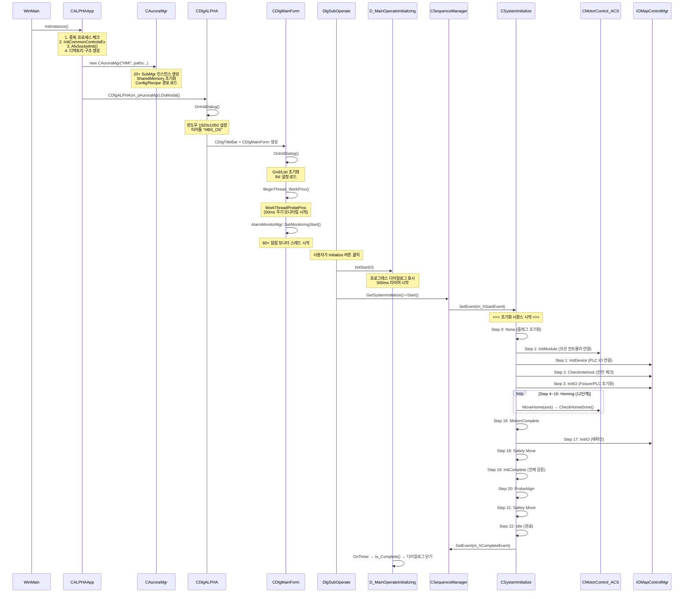
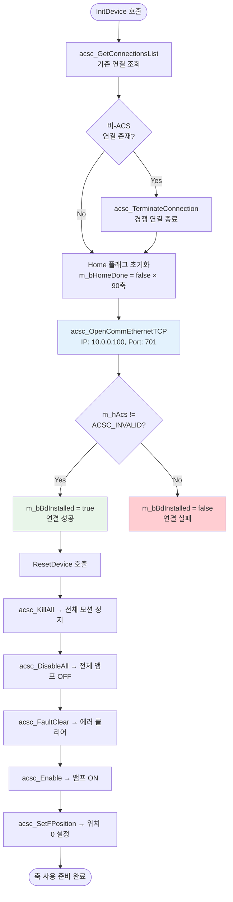
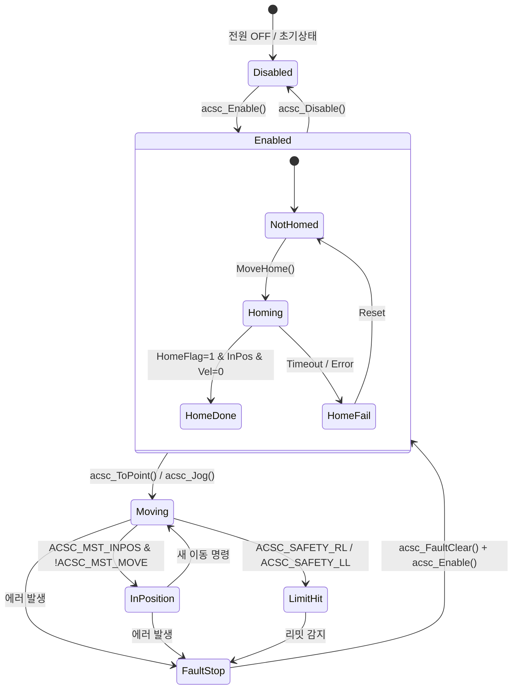
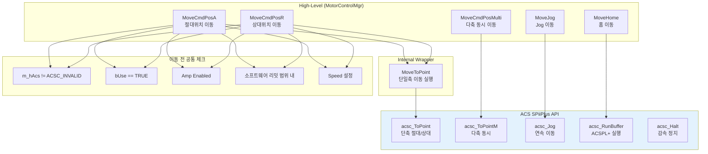
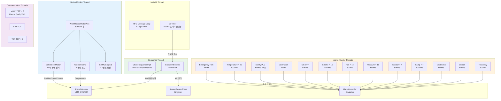
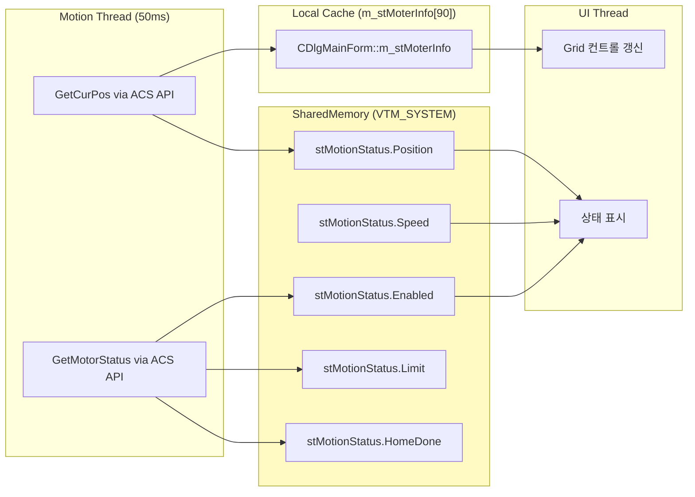
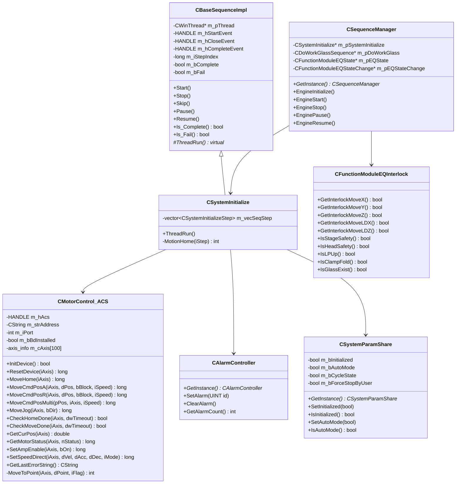

# ALPHA HMI - Initialize 동작 및 모션 초기화 구조 분석서

> **분석일:** 2026-05-22  
> **프로젝트:** D:\OCP\HMI\HMI (1)\Source\ALPHA\ALPHA.sln  
> **Motion Controller:** ACS SPiiPlus (Ethernet TCP/IP, ACSC Library v7.1.1.0)  
> **총 관리 축 수:** 90축 (AXIS_TYPE_END = 90, 배열 크기 df_USE_MAX_AXIS = 100)

---

## 목차

1. [프로그램 시작 ~ 초기화 전체 Sequence](#1-프로그램-시작--초기화-전체-sequence)
2. [ACS Motion 초기화 구조](#2-acs-motion-초기화-구조)
3. [Homing 및 초기 위치 설정](#3-homing-및-초기-위치-설정)
4. [Alarm 및 예외 처리](#4-alarm-및-예외-처리)
5. [Thread 및 실시간 구조](#5-thread-및-실시간-구조)
6. [핵심 클래스 역할 정리](#6-핵심-클래스-역할-정리)
7. [유지보수 관점 분석](#7-유지보수-관점-분석)

---

## 1. 프로그램 시작 ~ 초기화 전체 Sequence

### 1.1 Initialize 전체 Sequence Diagram



### 1.2 프로그램 시작 Flow 상세

#### 1단계: 애플리케이션 진입 (ALPHA.cpp)

```
CALPHAApp::InitInstance()
├─ CreateToolhelp32Snapshot() → 중복 프로세스 체크
├─ InitCommonControlsEx(ICC_WIN95_CLASSES)
├─ AfxSocketInit() → Windows Socket 초기화
├─ 디렉토리 구조 생성
│   ├─ Config 폴더
│   ├─ Recipe 폴더
│   ├─ Log 폴더
│   └─ Alarm 폴더
├─ new CAuroraMgr("HMI", strAppPath, strConfigPath, strRecipePath, strLogPath)
│   └─ 20+ SubMgr 생성 (SystemConfig, Network, Motor, IO, Alarm 등)
├─ SharedMemory 초기화
├─ 언어 로케일 설정 (KR/EN/CN)
└─ CDlgALPHA(m_pAuroraMgr).DoModal() → 메인 다이얼로그
```

#### 2단계: UI 초기화 (DlgALPHA.cpp → DlgMainForm.cpp)

```
CDlgALPHA::OnInitDialog()
├─ SetIcon (대/소)
├─ 윈도우 크기 1920x1050 (19인치 모니터)
├─ 타이틀 "HBS_OS" 설정
├─ CDlgTitleBar 생성 (0, 0, 1920, 80)
├─ CDlgMainForm 생성 (0, 81, 1920, 1049)
│   └─ CDlgMainForm::OnInitDialog()
│       ├─ Grid/List 컨트롤 초기화
│       ├─ LinkIniFile() → INI 설정 로드
│       ├─ BeginThread_WorkProc()
│       │   └─ AfxBeginThread(WorkThreadProbeProc) → 50ms 모니터링
│       └─ AlarmMonitorMgr::SetMonitoringStart()
│           ├─ EmergencyButton Monitor (200ms)
│           ├─ McOFF Monitor
│           ├─ Sensor Monitor (80+ 하위 모니터)
│           ├─ TeachKEY Monitor
│           └─ DoorOpen Monitor
└─ ShowWindow(SW_SHOWMAXIMIZED)
```

#### 3단계: 사용자 Initialize 트리거 (DlgSubOperate.cpp)

```
사용자: Initialize 버튼 클릭
├─ OnBnClickedButtonInit()
├─ m_pSystemInitializingDlg->InitStart(0)
│   ├─ ShowWindow(SW_SHOW) → 프로그레스 다이얼로그
│   └─ SetTimer(500ms) → 진행률 업데이트 타이머
└─ CSequenceManager::GetInstance()->GetSystemInitialize()->Start()
    ├─ ResetEvent(m_hCompleteEvent)
    └─ SetEvent(m_hStartEvent) → 시퀀스 스레드 깨움
```

### 1.3 Config / Recipe 로드 시점

| 항목 | 로드 시점 | 파일 |
|------|----------|------|
| CoreFunction.ini | CAuroraMgr 생성 시 | 하드웨어 설정 (Motor, IO, Camera) |
| Config.ini | CAuroraMgr 생성 시 | 소프트웨어 설정 (경로, 옵션) |
| IOMapConfig CSV | Step 1 InitModule | PLC IO 매핑 |
| AlarmMessage.csv | AlarmController 초기화 시 | 알람 메시지 |
| Recipe (.rcp) | Step 20 ProbeAlign | 프로브 정렬 레시피 |
| MotorConfig | Step 1 InitModule | 축별 파라미터 |

---

## 2. ACS Motion 초기화 구조

### 2.1 ACS Motion 초기화 Flow Diagram



### 2.2 Controller 연결 구성

```
┌─────────────────────────────────────────────────┐
│ ACS SPiiPlus Motion Controller                  │
│                                                 │
│  IP: 10.0.0.100                                │
│  Port: 701 (ACSC_SOCKET_STREAM_PORT)           │
│  Protocol: Ethernet TCP/IP                      │
│  Handle: m_hAcs (HANDLE, ACSC_INVALID = 초기값) │
│                                                 │
│  CoreFunction.ini 설정:                         │
│  [MOTOR_CONTROL_MGR]                           │
│  DEVICE_TYPE = ACS                             │
│  USE = 1                                       │
│  ADDRESS = 10.0.0.100                          │
│  PORT = 701                                    │
│  INTERLOCKPOS = 1200                           │
│  INTERLOCKGANGAP = 344                         │
│  INTERLOCKHEADGAP = 514                        │
│  INTERLOCKHEADGAPB = 714                       │
│  INTERLOCKPROBEGAP = 172.1                     │
└─────────────────────────────────────────────────┘
```

**소스 위치:** `D:\OCP\HMI\HMI (1)\CoreFunction\MotorFunction\MotorCtrl_ACS\MotorControl_ACS.cpp`

### 2.3 Axis Mapping 구조

총 90축이 `g_iMapAxis` CMap에 문자열→enum으로 매핑됨:

```cpp
// MotorControl_ACS.cpp, Lines 52-158
g_iMapAxis.SetAt(_T("X0-AXIS"),  AXIS_X0);    // Top Gantry
g_iMapAxis.SetAt(_T("Z1-AXIS"),  AXIS_Z1);    // Head1 Vision Z
g_iMapAxis.SetAt(_T("VZ2-AXIS"), AXIS_ZOOM2); // 29M Zoom
// ... 60+ 매핑
```

**주요 축 그룹:**

| 그룹 | 축 | 설명 |
|------|---|------|
| **Gantry/Stage** | X0, X2~X5 | Top Gantry, Head X축 |
| **Cross/Align** | Y0~Y8 | Head Y축 정렬 |
| **Rotation** | R0~R2 | 회전축 |
| **Focus/Height** | Z1~Z11 | 포커스/높이 Z축 |
| **Unit** | UNIT_Z, UNIT_Z2, UNIT_CROSS | 유닛 이동 |
| **Vision** | ZOOM1/2, THETA1/2, FILTER1/2, VLENS1/2 | 광학 모듈 |
| **Focus** | FOCUS1~4, ROTATE1~4 | 회전/포커스 |
| **Color/Specto** | COLOR_DEGREE1/2, SPECTO_DEGREE1/2 | 측색 |
| **Loader** | LOADER_X/Y/Z/R, LP, LP2 | 로더 시스템 |
| **Probe X** | PROBE_X1~X10 | 프로브 X축 (10축) |
| **Probe Y** | PROBE_Y1~Y5 | 프로브 Y축 (5축) |
| **Probe Z** | PROBE_Z1~Z5 | 프로브 Z축 (5축) |
| **Optical** | L, L2, WL1/2, UL1/2, XS/XS2, YS/YS2 | 광학 이동 |

### 2.4 Axis 데이터 구조 (axis_data_type)

```
AxisType.h, Lines 237-311
┌──────────────────────────────────────────────┐
│ struct axis_data_type                         │
├──────────────────────────────────────────────┤
│ BOOL bUse              // 축 사용 여부       │
│ int  iStepper          // 0=서보, 2=스텝퍼   │
│                                              │
│ === 속도 프로파일 (mm/min) ===               │
│ double dVelH/M/L       // High/Mid/Low 속도  │
│ double dVelHome        // 홈 속도             │
│ double dVelLatch       // 래치 속도           │
│                                              │
│ === 가속 시간 (msec) ===                     │
│ double dAccH/M/L       // High/Mid/Low 가속  │
│ double dAccHome        // 홈 가속             │
│                                              │
│ === S-Curve Jerk (msec) ===                  │
│ double dScvH/M/L       // High/Mid/Low 저크  │
│ double dScvHome        // 홈 저크             │
│                                              │
│ === 엔코더/스텝 설정 ===                     │
│ double dEncL           // 엔코더 길이 (um)    │
│ double dStpL           // 스텝 길이 (um)      │
│ double dPulse          // 펄스 카운트         │
│                                              │
│ === 위치 제한 (mm) ===                       │
│ double dDimCen         // 센터 위치           │
│ double dDimMax/Min     // 소프트웨어 리밋     │
│                                              │
│ === 홈 설정 ===                              │
│ double dOffset         // 홈 오프셋           │
│ double dHomePos        // 홈 후 기준위치      │
│ int    iNumHomePLC     // ACSPL+ 버퍼 번호   │
│                                              │
│ === 갠트리 설정 ===                          │
│ BOOL   bGantryAxis     // 갠트리 여부        │
│ int    iMasterAxis     // 마스터 축 번호     │
│ int    iSlaveAxis      // 슬레이브 축 번호   │
│                                              │
│ === 보정값 ===                               │
│ double dLensShift[10]  // 렌즈 보정          │
│ double dTubeShift[10]  // 튜브 보정          │
└──────────────────────────────────────────────┘
```

### 2.5 Servo ON/OFF 처리 방식

```mermaid
flowchart LR
    subgraph ServoON["Servo ON (SetAmpEnable(true))"]
        R1[ResetDevice] --> K1[acsc_Kill<br/>모션 정지]
        K1 --> D1[acsc_Disable<br/>앰프 OFF]
        D1 --> F1[acsc_FaultClear<br/>에러 클리어]
        F1 --> E1[acsc_Enable<br/>앰프 ON]
        E1 --> S1[acsc_SetFPosition(0)<br/>위치 리셋]
    end

    subgraph ServoOFF["Servo OFF (SetAmpEnable(false))"]
        K2[KillDevice] --> D2[acsc_Disable<br/>앰프 OFF]
        D2 --> H2[m_bHomeDone = false<br/>홈 플래그 클리어]
    end
```

**핵심 코드 (MotorControl_ACS.cpp:917-931):**
```cpp
long CMotorControl_ACS::SetAmpEnable(int iAxis, bool bOn)
{
    if (bOn == true)
        ResetDevice(iAxis);    // Kill → Disable → FaultClear → Enable → SetFPosition(0)
    else
    {
        KillDevice(iAxis);     // acsc_Disable
        m_cAxis[iAxis].m_bHomeDone = false;
    }
    return GetMotorStatus(iAxis, STATE_MOT_ENABLE);
}
```

### 2.6 Axis 상태 체크 구조



**Motor State 비트 플래그 (ACSC.h):**

| 플래그 | 값 | 의미 |
|--------|---|------|
| ACSC_MST_ENABLE | 0x00000001 | 앰프 활성화 |
| ACSC_MST_INPOS | 0x00000010 | 목표 위치 도달 |
| ACSC_MST_MOVE | 0x00000020 | 이동 중 |
| ACSC_MST_ACC | 0x00000040 | 가속 중 |

**Safety Fault 비트 플래그 (ACSC.h):**

| 플래그 | 값 | 의미 |
|--------|---|------|
| ACSC_SAFETY_RL | 0x00000001 | 양방향 리밋 히트 |
| ACSC_SAFETY_LL | 0x00000002 | 음방향 리밋 히트 |
| ACSC_SAFETY_CPE | 0x00002000 | Following Error 초과 |

**내부 상태 Enum (AxisType.h:213-227):**

| Enum | 값 | 의미 | 사용 API |
|------|---|------|---------|
| STATE_MOT_ENABLE | 0 | 앰프 ON | acsc_GetMotorState → ACSC_MST_ENABLE |
| STATE_MOT_DISABLE | 1 | 앰프 OFF | acsc_GetMotorState → !ACSC_MST_ENABLE |
| STATE_MOT_STOPMOT | 2 | 정지 상태 | acsc_GetMotorState → !ACSC_MST_MOVE |
| STATE_MOT_INPOSIT | 3 | 위치 도달 | acsc_GetMotorState → ACSC_MST_INPOS |
| STATE_MOT_LMTNEG | 4 | (−) 리밋 | acsc_GetFault → ACSC_SAFETY_LL |
| STATE_MOT_LMTPOS | 5 | (+) 리밋 | acsc_GetFault → ACSC_SAFETY_RL |
| STATE_MOT_STOPLMT | 6 | 리밋 정지 | - |
| STATE_MOT_ERRFLOW | 7 | Following Error | acsc_GetFault → ACSC_SAFETY_CPE |
| STATE_MOT_ERRPHAS | 8 | Phase Error | - |
| STATE_MOT_HOMCOMP | 9 | 홈 진행중 | - |
| STATE_MOT_HOMDONE | 10 | 홈 완료 | acsc_ReadInteger("HomeFlag") |

### 2.7 Gantry(Master/Slave) 초기화 구조

```
Gantry 축 쌍: AXIS_UNIT_Z / AXIS_Z9
- 속도 설정 시 양쪽 물리축에 동시 적용
- iAxis_mapping과 iAxis_mapping+1에 동일 파라미터 전달

SetSpeedDirect() 내부:
  for (i = iAxis_mapping; i <= iAxis_mapping + 1; i++)
  {
      acsc_SetVelocity(m_hAcs, i, dSetVel, NULL);
      acsc_SetAcceleration(m_hAcs, i, dSetAcc, NULL);
      acsc_SetDeceleration(m_hAcs, i, dSetAcc, NULL);
      acsc_SetKillDeceleration(m_hAcs, i, dSetJerk, NULL);
      acsc_SetJerk(m_hAcs, i, dSetJerk, NULL);
  }

axis_data_type 필드:
  bGantryAxis = TRUE      // 갠트리 축 식별
  iMasterAxis = 마스터 번호
  iSlaveAxis  = 슬레이브 번호
```

### 2.8 Encoder 값 초기 동기화

```cpp
// 홈 완료 후 위치 동기화
acsc_SetFPosition(m_hAcs, iAxis_mapping, 0.0, NULL);  // 피드백 위치 0 설정

// 위치 읽기 시 변환
double dFPosition;  // ACS 피드백 값 (raw)
acsc_GetFPosition(m_hAcs, m_cAxis[iAxis].m_iAxisMap, &dFPosition, NULL);

// 서보 모터: 그대로 사용
dPos = dFPosition;

// 스텝퍼 모터: 펄스→mm 변환
dPos = (dEncL * dFPosition) / dPulse;

// 최종 위치 = HomePos + (raw × direction)
dResult = dPos * m_cAxis[iAxis].m_iDir;
dResult2 = m_cAxis[iAxis].m_setting.dHomePos + dResult;
```

### 2.9 Motion Command Wrapper 구조



**Speed Profile 설정:**

| 모드 | Enum | 설명 |
|------|------|------|
| SPEED_HIGH | 0 | 고속 (dVelH, dAccH, dScvH) |
| SPEED_MID | 1 | 중속 (dVelM, dAccM, dScvM) |
| SPEED_LOW | 2 | 저속 (dVelL, dAccL, dScvL) |
| SPEED_HOME | 3 | 홈 속도 (dVelHome, dAccHome, dScvHome) |
| SPEED_LATCH | 4 | 래치 속도 (dVelLatch) |

**가감속 모드 (S-Curve):**

| 모드 | Enum | 설명 |
|------|------|------|
| SMODE_KEEP | -1 | 현재 유지 |
| SMODE_C | 0 | 등속 (S-Curve 없음) |
| SMODE_T | 1 | 사다리꼴 (선형 가감속) |
| SMODE_S | 2 | S-Curve (저크 제한) |

---

## 3. Homing 및 초기 위치 설정

### 3.1 Homing 전체 Flow

```mermaid
flowchart TD
    START([Homing 시작]) --> PRE_CHECK{사전 조건<br/>확인}
    PRE_CHECK -->|실패| FAIL_INIT([초기화 실패])
    PRE_CHECK -->|성공| STEP4

    subgraph HomingSequence["Homing 시퀀스 (Step 4~15)"]
        STEP4[Case 0: Lift Pin Z<br/>AXIS_LOADER_Z]
        STEP5[Case 1: Head Z축<br/>Z1,Z2 + 광학 20축]
        STEP6[Case 2: Reserved]
        STEP7[Case 3: Head XY<br/>X2,X3,Y1~Y4]
        STEP8[Case 4: Probe Z<br/>PROBE_Z1~Z5]
        STEP9[Case 5: Probe Y<br/>PROBE_Y1~Y5]
        STEP10[Case 6: Probe X<br/>PROBE_X1,X3,X5,X7,X9]
        STEP11[Case 7: Stage X<br/>AXIS_X]
        STEP12[Case 8: Stage R<br/>AXIS_LOADER_R]
        STEP13[Case 9: AC X 위치확인]
        STEP14[Case 10: AC Z<br/>AXIS_Z9]
        STEP15[Case 11: AC X<br/>AXIS_X4]
    end

    STEP4 --> STEP5 --> STEP6 --> STEP7
    STEP7 --> STEP8 --> STEP9 --> STEP10
    STEP10 --> STEP11 --> STEP12 --> STEP13
    STEP13 --> STEP14 --> STEP15

    STEP15 --> COMPLETE([Homing 완료<br/>Step 16: MotionComplete])

    subgraph EachStep["각 축 Homing 패턴"]
        MH[MoveHome<br/>acsc_RunBuffer]
        CHD[CheckHomeDone<br/>500ms 폴링]
        HF{HomeFlag=1<br/>InPos & Vel=0?}
        OF{Offset<br/>있음?}
        MO[Offset 이동<br/>MoveToPoint]
        SP[acsc_SetFPosition(0)<br/>위치 리셋]

        MH --> CHD --> HF
        HF -->|Yes| OF
        HF -->|No, Timeout| HFAIL[Homing 실패]
        OF -->|Yes| MO --> SP
        OF -->|No| SP
    end

    style HomingSequence fill:#f3e5f5
    style HFAIL fill:#ffcdd2
```

### 3.2 Homing 단계별 상세

#### Case 0: Lift Pin (AXIS_LOADER_Z)
```
MCC 액션: MCC_A_MOT_HOME_LIFT_PIN
홈 축:    AXIS_LOADER_Z
타임아웃: df_HOMINGDONE_TIME
```

#### Case 1: Head Z축 (핵심 - 가장 많은 축)
```
MCC 액션: MCC_A_MOT_HOME_HEAD + MCC_A_MOT_HOME_HEAD_Z
홈 순서:
  1. AXIS_Z1  (MCC_A_MOT_HOME_HEAD_Z_FRONT)  - Head1 Vision Z
  2. AXIS_Z2  (MCC_A_MOT_HOME_HEAD_Z_BACK)   - Head2 Vision Z
  3. AXIS_ZOOM1, AXIS_THETA1                   - 29M Zoom/Theta Head1
  4. AXIS_ZOOM2, AXIS_THETA2                   - 29M Zoom/Theta Head2
  5. AXIS_FILTER1, AXIS_FILTER2                - 광학 필터
  6. AXIS_VLENS1, AXIS_VLENS2                  - V렌즈
  7. AXIS_ROTATE1~4, AXIS_FOCUS1~4             - 회전/포커스 (8축)
  8. AXIS_COLOR_DEGREE1~2                      - 색도계
  9. AXIS_SPECTO_DEGREE1~2                     - 분광계

홈 후: CommTcpIpFactoryMgr::DoWorkSetParameter(enumTCPIpFactorytID_VISION)
       → Vision 서버에 파라미터 동기화
```

#### Case 3: Head XY축
```
MCC 액션: MCC_A_MOT_HOME_HEAD
홈 순서:
  1. AXIS_X2  (MCC_A_MOT_HOME_HEAD_X_BACK)       - Head X Back
  2. AXIS_X3  (MCC_A_MOT_HOME_HEAD_X_FRONT)      - Head X Front
  3. AXIS_Y1  (MCC_A_MOT_HOME_HEAD_Y_BACK_LEFT)  - Y Back Left
  4. AXIS_Y2  (MCC_A_MOT_HOME_HEAD_Y_BACK_RIGHT) - Y Back Right
  5. AXIS_Y3  (MCC_A_MOT_HOME_HEAD_Y_FRONT_LEFT) - Y Front Left
  6. AXIS_Y4  (MCC_A_MOT_HOME_HEAD_Y_FRONT_RIGHT)- Y Front Right
```

#### Case 4: Probe Z축
```
MCC 액션: MCC_A_MOT_HOME_PROBE_Z
홈 순서: AXIS_PROBE_Z1 → Z2 → Z3 → Z4 → Z5 (순차)
홈 후: MoveCmdPos_ProbeMove(AXIS_ALL_Z, 0, SPEED_HIGH)
       → 전체 프로브 Z를 0 위치로 이동
       Sleep(1000ms) 안정화 대기
```

#### Case 5: Probe Y축
```
MCC 액션: MCC_A_MOT_HOME_PROBE_Y
홈 전: SetProbeAlign(iProbe, false) → 정렬 플래그 초기화
홈 순서: AXIS_PROBE_Y1 → Y2 → Y3 → Y4 → Y5 (순차)
```

#### Case 6: Probe X축 (조건부 홈)
```
홈 대상: AXIS_PROBE_X1, X3, X5, X7, X9 (홀수만)
조건: 해당 축 또는 인접 축(iAxis+1)이 Disabled 상태일 때만 홈
      Enabled 상태: 위치 갭 계산 → 상대 이동으로 보정
```

#### Case 7: Stage X (안전 이동 포함)
```
MCC 액션: MCC_A_MOT_HOME_STAGE_X
사전 동작:
  1. PLC_AUTO_CHANGE_X0_POSITION_03 확인 (AC 안전 위치)
  2. 미도달 시: AXIS_X4 앰프 ON → +1000 상대 이동 → 60초 대기
     (위치 > 999 확인, 1초 간격 폴링)
홈 축: AXIS_X
```

#### Case 9: Auto Changer X 위치 확인
```
조건: IsPositionOnAC(2) → SACC 위치에 있는지 확인
동작: SACC 위치면 → AXIS_X4 앰프 ON → -1000 이동
      IsPositionOnAC(1) (SAFETY 위치) 될 때까지 60초 대기
```

### 3.3 Home 완료 판정 조건

```mermaid
flowchart TD
    START[CheckHomeDoneLoop 호출] --> READ[acsc_ReadInteger<br/>"HomeFlag" 배열 읽기]
    READ --> STATE[acsc_GetMotorState<br/>모터 상태 읽기]
    STATE --> VEL[GetActualVel<br/>실제 속도 읽기]
    VEL --> CHECK{HomeFlag[n]==1<br/>AND InPos<br/>AND Vel==0?}
    
    CHECK -->|No| RETRY[500ms 대기 후 재시도]
    RETRY --> TIMEOUT{Timeout<br/>초과?}
    TIMEOUT -->|Yes| FAIL([Home 실패])
    TIMEOUT -->|No| READ

    CHECK -->|Yes| SLEEP1[Sleep 500ms<br/>안정화]
    SLEEP1 --> CLAMP{iClamp == 0?}
    
    CLAMP -->|Yes<br/>Offset 없음| DONE1[m_bHomeDone = true]
    
    CLAMP -->|No<br/>Offset 있음| OFFSET[dOffset 값 확인]
    OFFSET --> MOVE_OFS[MoveToPoint(offset)]
    MOVE_OFS --> WAIT_MOVE[CheckMoveDone(120초)]
    WAIT_MOVE --> SLEEP2[Sleep 500ms]
    SLEEP2 --> SET_POS[acsc_SetFPosition(0)]
    SET_POS --> DONE2[m_bHomeDone = true]

    style FAIL fill:#ffcdd2
    style DONE1 fill:#e8f5e9
    style DONE2 fill:#e8f5e9
```

**완료 조건 3가지 동시 만족:**
1. `HomeFlag[iNumHomePLC] == 1` (ACS 컨트롤러 내부 홈 플래그)
2. `iState & ACSC_MST_INPOS` (In-Position 비트)
3. `GetActualVel() == 0` (실제 속도 0)

**특수 처리:**
- AXIS_LP 홈 완료 시 → AXIS_LP2도 자동 HomeDone 설정
- Offset 이동 시: |offset| < 1mm → SPEED_LOW, 그 외 → SPEED_MID

### 3.4 Home 실패 조건

| 실패 원인 | 감지 방법 | 에러 코드 |
|-----------|----------|-----------|
| Timeout 초과 | dwTimeout 비교 | MTOR_HOME_FAIL_ALARM |
| 앰프 Disable | GetMotorStatus(STATE_MOT_DISABLE) 10회 | - |
| 리밋 감지 | GetMotorStatus(STATE_MOT_LMTNEG/POS) | - |
| ACS 연결 끊김 | m_hAcs == ACSC_INVALID | -1 반환 |
| 사용자 정지 | GetStopUser() == true | 시퀀스 종료 |

### 3.5 Interlock 체크 구조 (초기화 중)

**Step 2: CheckInterlock에서 확인하는 항목:**

```
┌─────────────────────────────────────────────┐
│ 초기화 전 Safety Interlock 체크             │
├─────────────────────────────────────────────┤
│ ① 로더 암 센서 → OFF 필수                  │
│    IsLoaderArmSensorOn() == false           │
│    실패 코드: PLC_ARM_SENSOR_DETECT         │
│                                             │
│ ② 셔터 센서 → CLOSE 필수                   │
│    IsShutterSensorClose() == true           │
│    실패 코드: PLC_LOADER_SHUTTER_UP_ERROR   │
│                                             │
│ ③ X-Ray → OFF 필수                         │
│    IsX_RaySensorRunOn() == false            │
│    실패 코드: (generic)                     │
│                                             │
│ ④ 도어 센서 → CLOSE 필수                   │
│    IsDoorSensorClose() == true              │
│    실패 코드: PLC_DOOR_SENSOR_DETECT        │
└─────────────────────────────────────────────┘
```

**Step 3: InitIO에서 확인하는 항목:**

```
┌─────────────────────────────────────────────┐
│ IO 초기화 시 추가 체크                      │
├─────────────────────────────────────────────┤
│ ① 프로브 접촉 해제 확인                     │
│    IsProbeUnContactSensorOn(i) 전체 체크    │
│    접촉 감지 시: Z축 홈 → ProbeZ 홈 실행    │
│                                             │
│ ② 오토 체인저 Z 위치 확인                   │
│    IsACZxisDown() AND IsPositionOnAC()      │
│    미달 시: AC Z 홈 실행                    │
│                                             │
│ ③ 리프트핀 DOWN 확인                       │
│    IsLiftpinSensorDown() == true            │
│    확인 후: ResetIO() 실행                  │
│                                             │
│ ResetIO() 순서:                             │
│    1. Fixture Forward (8개, 60초 타임아웃)  │
│    2. Fixture Down (8개, 60초 타임아웃)     │
│    3. PLC Initialize 명령 → Complete 대기   │
└─────────────────────────────────────────────┘
```

---

## 4. Alarm 및 예외 처리

### 4.1 ACS Error 처리 방식

```mermaid
flowchart TD
    ERR[ACS 에러 발생] --> LASTERR[acsc_GetLastError<br/>에러 코드 획득]
    LASTERR --> ERRSTR[acsc_GetErrorString<br/>에러 메시지 변환]
    ERRSTR --> LOG[로그 기록<br/>"function returned error: %d (%s)"]

    MOTCHK[축 상태 체크] --> GETFAULT[acsc_GetFault<br/>Fault 비트 읽기]
    GETFAULT --> MOTERR[acsc_GetMotorError<br/>모터 에러 코드]
    MOTERR --> CHECK{iMotErr > 0?}
    CHECK -->|Yes| RETURN_ERR[에러 코드 반환]
    CHECK -->|No| DECODE[비트 디코딩<br/>RL/LL/CPE 등]

    subgraph FaultBits["Fault 비트 매핑"]
        RL[ACSC_SAFETY_RL<br/>양방향 리밋]
        LL[ACSC_SAFETY_LL<br/>음방향 리밋]
        CPE[ACSC_SAFETY_CPE<br/>Following Error]
    end

    DECODE --> FaultBits
```

### 4.2 Motion Timeout 처리

**CheckMoveDone 타임아웃 패턴:**
```cpp
// MotorControl_ACS.cpp:682-737
ULONGLONG dwStart = GetTickCount();
do {
    WaitForSingleObject(m_hWaitTimeEvent, 50);  // 50ms 간격 폴링

    // 1. 앰프 Disable 체크
    if (GetMotorStatus(iAxis, STATE_MOT_DISABLE) != 0)
        return false;  // 앰프 꺼짐 → 실패

    // 2. 리밋 히트 체크
    if (GetMotorStatus(iAxis, STATE_MOT_LMTNEG) != 0)
        return false;  // (−) 리밋
    if (GetMotorStatus(iAxis, STATE_MOT_LMTPOS) != 0)
        return false;  // (+) 리밋

    // 3. 완료 조건: !Moving AND InPosition
    if ((iState & ACSC_MST_MOVE) == 0 && (iState & ACSC_MST_INPOS) != 0)
        return true;   // 이동 완료

    // 4. 타임아웃 체크
    if ((GetTickCount() - dwStart) > dwTimeout * 1000)
        return false;  // 타임아웃
} while(1);
```

### 4.3 초기화 실패 시 처리 구조

```mermaid
flowchart TD
    STEP[Step N 실행<br/>pSeqItem->Run()] --> RESULT{결과}
    RESULT -->|true| NEXT[GoToNextStep<br/>다음 단계]
    RESULT -->|false| EXIT_CHECK{현재 == Exit Step?}
    
    EXIT_CHECK -->|Yes| NORMAL_END[정상 완료 처리]
    EXIT_CHECK -->|No| SET_FAIL[SetFail(true, nErrorCode)]
    SET_FAIL --> GO_EXIT[GoToExitStep()<br/>Step 22로 점프]
    GO_EXIT --> RUN_EXIT[Exit Step 실행<br/>(Idle 상태 진입)]
    RUN_EXIT --> COMPLETE[SetEvent(m_hCompleteEvent)]
    COMPLETE --> UI_NOTIFY[UI: Is_Fail() 감지<br/>에러 다이얼로그]

    STOP{사용자 Stop?} -->|Yes| GO_EXIT

    style SET_FAIL fill:#ffcdd2
    style UI_NOTIFY fill:#fff3e0
```

**에러 코드 목록:**

| 에러 코드 | 발생 단계 | 의미 |
|-----------|----------|------|
| PLC_ARM_SENSOR_DETECT | Step 2 | 로더 암 감지 |
| PLC_DOOR_SENSOR_DETECT | Step 2 | 도어 열림 |
| PLC_LOADER_SHUTTER_UP_ERROR | Step 2 | 셔터 열림 |
| MEI_INIT_MC_FAIL | Step 1 | 모션 컨트롤러 초기화 실패 |
| PLC_INITIAL_FAIL | Step 3 | PLC 초기화 실패 |
| PLC_STATE_UNKNOWN_ERROR | Step 19 | 설비 상태 이상 |
| MOTION_INTERLOCK_6 | Step 3 | 인터록 위반 |
| JOB_PROC_SAFETY_POS_ERROR | Step 18 | Safety 이동 실패 |
| MTOR_HOME_FAIL_ALARM | Step 4~15 | 홈 실패 |
| PLC_FIXTURE_CYLINDER_FWD_ERROR | Step 3 | 실린더 FWD 실패 |
| PLC_FIXTURE_CYLINDER_DOWN_ERROR | Step 3 | 실린더 DOWN 실패 |
| PLC_SOCKET_CREATE_FAIL | Step 1 | 통신 소켓 생성 실패 |

### 4.4 Recovery 구조 및 Retry 로직

**현재 구현 상태:**
- **Retry 로직 없음**: 각 단계 실패 시 즉시 Exit Step으로 점프
- **Recovery**: 사용자가 수동으로 원인 해결 후 재초기화 필요
- **Emergency 처리**: AlarmMonitorToEmergency 스레드가 상시 감시
- **디바운싱**: Emergency 버튼 3회 연속 감지 후 알람 발생 (200ms × 3 = 600ms 이상)

### 4.5 Alarm Monitor 폴링 패턴

| 모니터 | 폴링 주기 | 디바운스 | 감시 대상 |
|--------|----------|---------|-----------|
| Emergency Button | 200ms | 3회 | PLC IO 비트 |
| Temperature | 1000ms | 즉시 | PLC IO 비트 |
| Safety PLC | 500ms | 3회 | Ping 192.168.250.1 |
| Door Open | ~200ms | - | PLC IO 비트 |
| MC OFF | ~500ms | - | MC 접점 상태 |
| Smoke Detector | ~1000ms | - | 16개 센서 |
| Fan Status | ~500ms | - | 14개 팬 |
| Pressure | ~500ms | - | 16개 압력 |
| Vacuum Switch | ~500ms | - | 진공 스위치 |

---

## 5. Thread 및 실시간 구조

### 5.1 Thread 구조도



### 5.2 WorkThreadProbeProc 상세 (50ms 주기)

```
WorkThreadProbeProc (DlgMainForm.cpp)
│
├─ WaitForSingleObject(m_hEvtKillThread, 50)  ← 50ms 폴링
│
├─ GetMonitorMotion()
│   └─ for each axis (0 ~ AXIS_TYPE_END):
│       if (bUse == TRUE):
│           ├─ GetCurPos(iAxis)        → m_stMoterInfo[i].dPosition
│           ├─ GetMotorRMSValue(iAxis) → m_stMoterInfo[i].dRMS  
│           ├─ GetSpeedVal(iAxis)      → m_stMoterInfo[i].dSpeed
│           ├─ GetAmpEnable(iAxis)     → m_stMoterInfo[i].bEnabled
│           ├─ GetHWLimit(+/-)         → m_stMoterInfo[i].bLimitP/N
│           ├─ GetHomeDone(iAxis)      → m_stMoterInfo[i].bHomeDone
│           ├─ SharedMemory 갱신       → stMotionStatus[iAxis]
│           └─ MCC 로깅               → SetMccMoterInfoCur()
│
├─ GetMonitorIO()
│   └─ for temp (0 ~ 19):
│       ├─ GetFDCDValue(FDC_WDATA_TEMP_1 + i) → 온도 읽기
│       └─ if (temp > max): SetSys_TemperOver(i, true)
│
└─ SetMCCSignal()
    └─ PLC 비트 읽기 → m_bMccSignal[] 갱신
```

### 5.3 UI와 Motion Thread 간 데이터 공유



### 5.4 Deadlock 가능성 분석

| 위험 구간 | 상세 | 위험도 |
|-----------|------|-------|
| **CheckMoveDone 무한루프** | `do-while(1)` + 타임아웃 체크, 타임아웃 없으면 무한 대기 | 중간 |
| **CheckHomeDone 무한루프** | 500ms 간격 폴링, dwTimeout 파라미터로 제한 | 중간 |
| **WaitActionDone** | PLC 비트 폴링, 60초 타임아웃 | 낮음 |
| **CCriticalSection** | SharedMemory 읽기/쓰기 분리 (m_cs_set/m_cs_get) | 낮음 |
| **ACS API 호출** | NULL 콜백 (동기 호출), API 내부 타임아웃 존재 | 낮음 |
| **Safety Move 대기** | 100초 × 100ms 폴링, 상한 있음 | 낮음 |

### 5.5 Busy Wait 구조

| 위치 | 패턴 | 개선 가능성 |
|------|------|------------|
| CheckMoveDone | 50ms WaitForSingleObject | 적절 |
| CheckHomeDone | 500ms WaitForSingleObject | 적절 |
| AlarmMonitor | 10ms WaitForSingleObject + Sleep | 적절 |
| WorkThreadProbeProc | 50ms WaitForSingleObject | 적절 |
| MotionHome Case 7 | Sleep(1000) 루프 + 조건 체크 | **개선 가능** (이벤트 기반) |
| MotionHome Case 9 | Sleep(1000) 루프 + 조건 체크 | **개선 가능** (이벤트 기반) |
| Safety Move | Sleep(100) × 1000 루프 | **개선 가능** (이벤트 기반) |

---

## 6. 핵심 클래스 역할 정리

### 6.1 Motion 관련 핵심 클래스



### 6.2 클래스별 소스 위치

| 클래스 | 소스 위치 | 역할 |
|--------|----------|------|
| CMotorControl_ACS | CoreFunction\MotorFunction\MotorCtrl_ACS\ | ACS API 래퍼 |
| CMotorControlMgr | Manager\MotorControlMgr.cpp | 모터 제어 매니저 |
| CBaseSequenceImpl | BaseSequenceImpl.cpp | 시퀀스 스레딩 베이스 |
| CBaseSequenceBody | BaseSequenceBody.h | 시퀀스 상태/멤버 |
| CSystemInitialize | DoWork\SystemInitialize.cpp | 초기화 시퀀스 |
| CSystemInitializeStep | DoWork\SystemInitializeStep.cpp | 초기화 개별 단계 |
| CSequenceManager | Manager\SequenceManager.cpp | 시퀀스 총괄 (Singleton) |
| CFunctionModuleEQState | FunctionModule\FunctionModuleEQState.cpp | 설비 상태 관리 |
| CFunctionModuleEQStateChange | FunctionModule\FunctionModuleEQStateChange.cpp | 상태 전이 |
| CFunctionModuleEQInterlock | FunctionModule\FunctionModuleEQInterlock.cpp | 인터록 체크 |
| CSystemParamShare | SystemParamShare.cpp | 전역 상태 (Singleton) |
| CAlarmController | Alarm\AlarmController.cpp | 알람 관리 (Singleton) |
| CAlarmMonitorMgr | Alarm\AlarmMonitorMgr.cpp | 알람 모니터 관리 |
| CD_MainOperateInitializing | D_MainOperateInitializing.cpp | 초기화 UI |
| CDlgMainForm | DlgMainForm.cpp | 메인 폼 + 모니터링 스레드 |

### 6.3 Singleton 사용 현황

| 클래스 | 접근 방법 | 관리 데이터 |
|--------|----------|------------|
| CSequenceManager | GetInstance() | 시퀀스 인스턴스, 상태 머신 |
| CSystemParamShare | GetInstance() | 전역 상태, 경로, Glass 정보 |
| CAlarmController | GetInstance() | 알람 목록, 알람 이력 |
| CMCCLogMgr | GetInstance() | MCC 로그, FDC 데이터 |

---

## 7. 유지보수 관점 분석

### 7.1 위험한 초기화 순서

```
⚠️ 위험 구간 1: Case 7 (Stage X)
   - AXIS_X4 앰프 ON → 상대 이동 +1000
   - 60초 Sleep(1000) 루프로 위치 확인
   - AC 위치 미확인 시 충돌 가능성
   → 개선: 이동 전 인터록 강화, WaitForSingleObject 패턴으로 전환

⚠️ 위험 구간 2: Case 6 (Probe X)
   - 조건부 홈: Enabled 축은 상대 이동으로 보정
   - 갭 계산 오류 시 프로브 충돌 가능
   → 개선: 갭 허용 범위 검증 추가

⚠️ 위험 구간 3: Step 3 InitIO
   - 프로브 접촉 감지 시 Z축 홈 → ProbeZ 홈 순차 실행
   - 이 과정에서 다른 축은 임의 위치
   → 개선: 접촉 해제 전용 시퀀스 분리

⚠️ 위험 구간 4: ResetDevice (전체 리셋)
   - acsc_KillAll → acsc_DisableAll → FaultClear → Enable → SetFPosition(0)
   - 중간에 실패 시 부분 활성화 상태
   → 개선: 각 단계 반환값 체크 추가
```

### 7.2 축 추가 시 영향 범위

```
새 축 추가 체크리스트:
┌──────────────────────────────────────────────────────┐
│ 1. AxisType.h                                        │
│    └─ axis_type_t enum에 축 추가 (AXIS_TYPE_END 변경)│
│                                                      │
│ 2. MotorControl_ACS.cpp                              │
│    └─ g_iMapAxis.SetAt() 매핑 추가                   │
│                                                      │
│ 3. CoreFunction.ini                                  │
│    └─ 축 파라미터 설정 (속도, 가속, 리밋)            │
│                                                      │
│ 4. MotorConfig CSV                                   │
│    └─ 축 설정 데이터 추가                            │
│                                                      │
│ 5. SystemInitialize.cpp (MotionHome)                 │
│    └─ 해당 Case에 홈 순서 추가                       │
│                                                      │
│ 6. FunctionModuleEQInterlock.cpp                     │
│    └─ 인터록 조건에 축 추가                          │
│                                                      │
│ 7. DlgMainForm.cpp (GetMonitorMotion)                │
│    └─ 모니터링 대상에 축 추가                        │
│                                                      │
│ 8. ACS 컨트롤러 내부                                │
│    └─ ACSPL+ 프로그램 버퍼에 홈 루틴 추가           │
│    └─ HomeFlag 배열 인덱스 할당                      │
│                                                      │
│ ⚠️ m_stMoterInfo[90] 배열 크기 확인 필요            │
│ ⚠️ df_USE_MAX_AXIS = 100 범위 내 확인               │
└──────────────────────────────────────────────────────┘
```

### 7.3 하드코딩 구조

| 항목 | 위치 | 값 | 위험도 |
|------|------|---|-------|
| ACS IP | CoreFunction.ini → 코드 | 10.0.0.100 | 낮음 (INI) |
| ACS Port | CoreFunction.ini → 코드 | 701 | 낮음 (INI) |
| Safety PLC IP | AlarmMonitorToSafetyPLC | 192.168.250.1 | **높음** (하드코딩) |
| HomeFlag 배열 크기 | CheckHomeDoneLoop | 64 | 중간 |
| 축 배열 크기 | AxisType.h | 100 | 중간 |
| Gantry 축 쌍 | SetSpeedDirect | AXIS_UNIT_Z, AXIS_Z9 | **높음** (하드코딩) |
| Fixture 개수 | ResetIO | 8 | **높음** (하드코딩) |
| 온도 채널 수 | GetMonitorIO | 20 | 중간 |
| 프로브 수 | 여러 곳 | 5 | 중간 |
| 타임아웃 값 | 여러 곳 | 60/100/120초 | 중간 |
| 상대이동 거리 | Case 7, 9 | ±1000 | **높음** |

### 7.4 중복된 Motion Command

| 중복 패턴 | 위치 | 설명 |
|-----------|------|------|
| 리밋 체크 | MoveCmdPosA, MoveCmdPosR | 동일한 dDimMax/Min 비교 |
| 앰프 체크 | 모든 Move 함수 | GetMotorStatus(STATE_MOT_DISABLE) 반복 |
| 스텝퍼 변환 | MoveToPoint, GetCurPos, SetSpeedDirect | 동일 펄스 변환 로직 3중 구현 |
| 핸들 체크 | 모든 함수 시작 | m_hAcs == ACSC_INVALID 반복 |

**개선 제안:**
```
1. PreMoveCheck(iAxis) 함수 추출 → 핸들/사용/앰프/리밋 통합 체크
2. ConvertStepperPosition(iAxis, dPos) → 스텝퍼 변환 함수 통합
3. IsValidConnection() → ACS 연결 유효성 통합
```

### 7.5 인터락 누락 가능성

```
⚠️ 인터락 누락 위험 항목:

1. Case 7 (Stage X) 상대 이동 +1000
   → 인터록 없이 이동 시작
   → 소프트웨어 리밋만 체크 (MoveToPoint 내부)
   
2. Case 9 (AC X) 상대 이동 -1000
   → IsPositionOnAC 확인만, 이동 중 인터록 미적용
   
3. Probe X (Case 6) 갭 보정 이동
   → 갭 값 기반 상대 이동, 범위 검증 미흡
   
4. Home Offset 이동
   → MoveToPoint 후 CheckMoveDone(120초)
   → 이동 중 인터록 없음 (CheckMoveDone은 리밋만 체크)
```

### 7.6 Race Condition 가능성

| 위치 | 상세 | 위험도 |
|------|------|-------|
| **WorkThread vs ACS API** | 50ms 모니터링에서 GetCurPos 호출 중 시퀀스 스레드에서 MoveCmdPosA 호출 | **중간** |
| **AlarmMonitor vs Sequence** | 알람 발생 시 시퀀스 중단 → 모션 정지 타이밍 | 낮음 |
| **SharedMemory 갱신** | Position 값 읽기/쓰기 비동기 | 낮음 (CCriticalSection) |
| **m_bHomeDone 플래그** | 홈 완료 → 이동 명령 시 플래그 체크 없음 | **중간** |
| **ACS Handle 무효화** | 연결 끊김 시 m_hAcs 무효 → 진행 중인 API 호출 | **높음** |

### 7.7 개선 권장 구조

```
┌─────────────────────────────────────────────────────────┐
│ 1. Motion Command Guard 패턴 도입                       │
│    → PreMoveValidation 함수에 인터록 + 안전 통합 체크   │
│                                                         │
│ 2. ACS 연결 감시 스레드 추가                            │
│    → Heartbeat 패턴으로 연결 상태 감시                  │
│    → 끊김 감지 시 전체 모션 Emergency Stop              │
│                                                         │
│ 3. 스텝퍼 변환 로직 통합                                │
│    → ConvertPosition/Velocity 메서드 추출               │
│                                                         │
│ 4. Homing 루프의 Sleep 패턴 개선                       │
│    → WaitForSingleObject + 타임아웃으로 교체            │
│                                                         │
│ 5. 초기화 Retry 로직 도입                              │
│    → 통신 실패: 3회 재시도                              │
│    → 홈 실패: 1회 재시도 (축별)                        │
│                                                         │
│ 6. 하드코딩 상수 INI 파일 이관                         │
│    → Safety PLC IP                                     │
│    → Gantry 축 쌍 정의                                 │
│    → 이동 거리 (±1000)                                 │
│    → Fixture 수량                                      │
│                                                         │
│ 7. 인터록 매트릭스 도입                                │
│    → 축별 이동 가능 조건을 테이블화                    │
│    → 런타임 체크 자동화                                │
│                                                         │
│ 8. Alarm Monitor 통합                                   │
│    → 80+ 개별 스레드 → 폴링 스레드 3~5개로 통합       │
│    → 센서 유형별 그룹핑 + 이벤트 디스패치              │
└─────────────────────────────────────────────────────────┘
```

---

## 부록 A: ACS SPiiPlus API 사용 목록

### 연결 관리
| API | 용도 | 사용 위치 |
|-----|------|----------|
| acsc_OpenCommEthernetTCP | TCP 연결 | InitDevice |
| acsc_CloseComm | 연결 종료 | 소멸자 |
| acsc_GetConnectionsList | 연결 목록 | InitDevice |
| acsc_TerminateConnection | 연결 강제 종료 | InitDevice |

### 모션 명령
| API | 용도 | 사용 위치 |
|-----|------|----------|
| acsc_ToPoint | 단축 이동 | MoveToPoint |
| acsc_ToPointM | 다축 동시 이동 | MoveCmdPosMulti |
| acsc_Jog | 연속 이동 | MoveJog |
| acsc_Halt | 감속 정지 | StopDevice |
| acsc_Kill / acsc_KillAll | 즉시 정지 | ResetDevice, KillDevice |

### 앰프 제어
| API | 용도 | 사용 위치 |
|-----|------|----------|
| acsc_Enable | 앰프 ON | ResetDevice |
| acsc_Disable / acsc_DisableAll | 앰프 OFF | ResetDevice, KillDevice |
| acsc_FaultClear | 에러 클리어 | ResetDevice |

### 상태 조회
| API | 용도 | 사용 위치 |
|-----|------|----------|
| acsc_GetMotorState | 모터 상태 비트 | GetMotorStatus, CheckMoveDone |
| acsc_GetFault | 폴트 비트 | GetMotorStatus |
| acsc_GetMotorError | 모터 에러 코드 | GetMotorStatus |
| acsc_GetFPosition | 피드백 위치 | GetCurPos |
| acsc_SetFPosition | 위치 설정 | ResetDevice, CheckHomeDoneLoop |
| acsc_GetRVelocity | 실제 속도 | GetActualVel |
| acsc_GetInput | 디지털 입력 | GetInput |
| acsc_WaitMotionEnd | 이동 완료 대기 | WaitMotionEnd |

### 파라미터 설정
| API | 용도 | 사용 위치 |
|-----|------|----------|
| acsc_SetVelocity | 속도 설정 | SetSpeedDirect |
| acsc_SetAcceleration | 가속도 설정 | SetSpeedDirect |
| acsc_SetDeceleration | 감속도 설정 | SetSpeedDirect |
| acsc_SetKillDeceleration | 긴급 감속 | SetSpeedDirect |
| acsc_SetJerk | 저크 설정 | SetSpeedDirect |

### 프로그램 제어
| API | 용도 | 사용 위치 |
|-----|------|----------|
| acsc_RunBuffer | ACSPL+ 실행 | MoveHome, RunBuffer |
| acsc_StopBuffer | ACSPL+ 정지 | StopBuffer |

### 변수 읽기/쓰기
| API | 용도 | 사용 위치 |
|-----|------|----------|
| acsc_ReadInteger | 정수 변수 읽기 | CheckHomeDoneLoop (HomeFlag) |
| acsc_ReadReal | 실수 변수 읽기 | GetFollowingErr (FPOS) |
| acsc_WriteInteger | 정수 변수 쓰기 | CheckInterlock |

### 에러 처리
| API | 용도 | 사용 위치 |
|-----|------|----------|
| acsc_GetLastError | 에러 코드 | GetLastErrorString |
| acsc_GetErrorString | 에러 메시지 | GetLastErrorString |

---

## 부록 B: 초기화 진행률 표시 단계

| Step | 진행률 | 표시 메시지 |
|------|-------|------------|
| 0 | 0% | Initializing... |
| 1 | 5% | Initializing...InitModule |
| 2 | 9% | Initializing...CheckInterlock |
| 3 | 14% | Initializing...InitIO |
| 4 | 18% | Initializing...MotionHoming 1. Lift Pin |
| 5 | 23% | Initializing...MotionHoming 2. Z Axis |
| 6 | 27% | Initializing...MotionHoming |
| 7 | 32% | Initializing...MotionHoming 3. Head X / Y |
| 8 | 36% | Initializing...MotionHoming 4. Probe Z |
| 9 | 41% | Initializing...MotionHoming 5. Probe Cross |
| 10 | 45% | Initializing...MotionHoming 6. Probe Gantry |
| 11 | 50% | Initializing...MotionHoming 7. Stage |
| 12 | 55% | Initializing...MotionHoming 8. Stage Rotate |
| 13 | 59% | Initializing...MotionHoming 9. Auto Change Pos Check |
| 14 | 64% | Initializing...MotionHoming 10. Auto Change Z |
| 15 | 68% | Initializing...MotionHoming 11. Auto Change |
| 16 | 73% | Initializing...MotionComplete |
| 17 | 77% | Initializing...InitIO |
| 18 | 82% | Initializing...Move Safety |
| 19 | 86% | Initializing...InitComplete |
| 20 | 91% | Initializing...Probe Align |
| 21 | 95% | Initializing...Move Safety |
| 22 | 100% | Complete (Idle) |

---

> **문서 끝**  
> 이 문서는 ALPHA HMI 프로젝트의 Initialize 동작 및 ACS Motion 초기화 구조를 분석하여 작성되었습니다.
