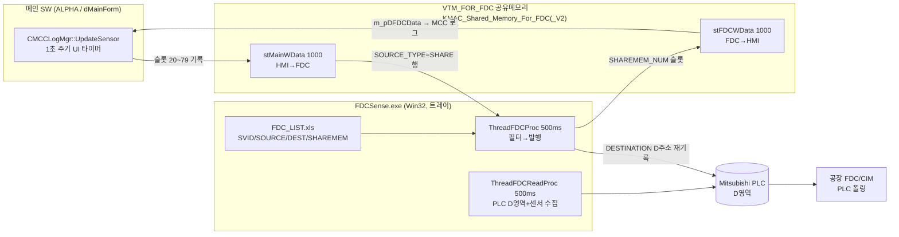

# FDC 프로그램 구조 비교 — HMI 독립형 vs GAI 인솔루션형

| 항목 | 내용 |
|---|---|
| 비교 대상 A | HMI(분판검사기) 독립형: `D:\OCP\0.SW_Matching\FDC\FDC_Ver1.0.1.24\FDCSense.sln` |
| 비교 대상 B | GAI 인솔루션형: `D:\IT8.6G\GAI\IT_8.6G_HBS_GAI\IT_8.6G_HBS.sln` 내 `Ex_FDC\` (FDCSense + SocketControl + MXComponent 3개 프로젝트) |
| 작성일 | 2026-07-29 |
| 결론 요약 | **관리 관점에서는 GAI 인솔루션형이 우위.** HMI 독립형은 "배포 바이너리(2022-03-24)의 소스 부재 + 보유 소스는 현행 HMI와 비호환"이라는 실증된 관리 실패 상태. 단, 인솔루션형도 헤더 사본 드리프트는 자동 해결되지 않으므로(GAI에서 실증) 공유 include 단일화를 병행해야 함 |

---

## 1. 공통 기반 (두 FDC는 같은 계보)

두 프로그램 모두 동일 계보의 `FDCSense` MFC 다이얼로그 앱(Win32, **MultiByte**, 트레이 상주)이며 역할이 같다:

```
[수집] PLC D영역 500ms 폴링(MC Protocol/MXComponent) + 센서(Serial/SensorView) + ACCURA + 레지스트리
   ↓ FDC_LIST.xls 포인트 테이블 (SVID / SOURCE_TYPE{PLC,SENSOR,SHARE,CAPA,SELF,REG} / DESTINATION / SHAREMEM_NUM / 필터)
[발행] ① 공유메모리 stFDCWData[] (HMI가 읽어 MCC 로그로)
       ② PLC D영역 재기록(DESTINATION 주소) ← 공장 FDC/CIM은 PLC를 폴링 — 팹 업로드는 PLC의 몫, exe에 FTP 없음
       ③ FFU TCP 서버(Port 7012)
       ④ 주기 파일 로그 (ILog 10초 등)
```

HMI(메인 SW)와의 계약은 **파일 매핑 + 구조체 헤더**:
- 매핑: `CreateFileMapping(INVALID_HANDLE_VALUE, …)` — 먼저 뜬 쪽이 생성, 나중 쪽이 attach
- 구조체: `VTM_FOR_FDC { int nMainDataCount; RDATA stMainWData[N]; DWORD lLiveCheck; RDATA stFDCWData[1000]; }`, `RDATA{ char szName[32]; char szData[32]; double nMax, nMin; }` (80B)
- 방향: `stMainWData` = **HMI→FDC** (FDC는 FDC_LIST의 `SOURCE_TYPE=SHARE` 행에서 `SOURCE_ADDRESS`로 **슬롯 직접 인덱싱** — `nMainDataCount`는 실사용 안 함), `stFDCWData` = **FDC→HMI** (MCCLogMgr가 읽어 `m_pDFDCData[]`로)
- 계약 문서는 없고 **`FDCSheardDefine.h` 헤더 파일 자체가 계약** — 양쪽 코드베이스에 수동 복사

## 2. 구조 차이 비교표

| 항목 | A. HMI 독립형 | B. GAI 인솔루션형 |
|---|---|---|
| 솔루션 형태 | 별도 `FDCSense.sln` (단일 프로젝트, AnkhSVN 흔적) | 메인 `IT_8.6G_HBS.sln`에 3개 프로젝트 등록 (FDCSense/SocketControl/MXComponent), 전용 구성 `FDC_D`/`FDC_R` |
| 툴셋 | VS2010 포맷, ToolsVersion 4.0 | **v142** (메인 솔루션과 동일 세대) |
| 플랫폼 | Win32 전용 | Win32 (x64 솔루션 내 공존 — `FDC_R\|x64` 구성이 FDCSense를 `Release\|Win32`로 매핑) |
| 출력/배포 | `Release\` → PostBuild로 `..\Bin` 복사, 폴더째 배포 + HKCU Run 자동실행 | `BIN_FDC\FDCSense.exe` (PostBuild 복사) — 리포 내 배포 폴더 일원화 |
| 라이브러리 | `..\Lib\*.lib` + **`D:\EXTRN\` 절대경로 소스 2종 참조** (그 트리 없으면 빌드 불가) | 리포 내 자급 (SocketControl/MXComponent도 소스로 보유) |
| 헤더 사본 | **3중**: HMI `Source\Include\FDCSheardDefine.h`(124줄) / FDC 소스 `Include\`(1,684줄, 사장 코드 다수) / 배포본 옆 `FDC\0324\FDC\`(2022) | **2중**: `Ex_FDC\Include\`(362줄) / 부모 `Include\`(393줄) — FDCSense는 부모 Include를 참조하지 않음 |
| 헤더 정합 상태 | **비호환 3종 세트**: 매핑명(`KMAC_Shared_Memory_For_FDC` vs 현행 `_V2`), `stFDCWData[100]` vs `[1000]`, 인덱스 베이스(`FDC_WDATA_TEMP_1`=0 vs 1) + 쓰기 가드 `if (nIndex < 100)`(DlgPLC.cpp:1014) 하드코딩 | 13개월 드리프트 존재(부모에 MAIN_WDATA 항목 추가됨) — 단 영역 앵커가 명시 리터럴(400/301/4000/1000)이라 **레이아웃은 아직 일치** |
| 소스-바이너리 정합 | **불일치(치명)**: 배포 바이너리는 2022-03-24 빌드인데 대응 소스가 어디에도 없음. 보유 소스(1.0.1.24)는 2021년판으로 현행 HMI와 통신 불가 | 일치: BIN_FDC 바이너리(2025-02-01)가 솔루션 빌드 산출물 |
| 신호 추가 작업 | HMI 수정 + (소스 없는) FDC는 FDC_LIST.xls로만 대응 가능, 코드 변경 필요 시 **재빌드 불가능 상태** | HMI(dMainForm) 수정 + Ex_FDC 헤더 복사 + FDC_LIST.xls — 한 리포에서 한 변경 단위로 처리, 즉시 빌드 검증 |

## 3. 실증된 관리 사고 (HMI 독립형)

1. **소스 유실**: 배포 중인 `FDCSense.exe`(2022-03-24, `FDC\0324\`)의 소스 트리가 `D:\OCP\0.SW_Matching\FDC\` 어디에도 없음. 버전 이력(`Bin\FDC_History.txt`)도 1.0.1.23(2022-01-29)에서 끊김(폴더명은 1.0.1.24).
2. **보유 소스 비호환**: 지금 `FDC_Ver1.0.1.24` 소스를 빌드해도 현행 ALPHA(`KMAC_Shared_Memory_For_FDC_V2`, stFDCWData[1000], TEMP_1=1)와 **다른 매핑을 열어 서로를 영원히 못 봄**. 재사용하려면 최소 4곳 수정 필요(매핑명, 배열 크기, 인덱스 베이스에 따른 FDC_LIST SHAREMEM_NUM 전체 시프트, `nIndex<100` 가드).
3. **계약 관리 부재**: 헤더에 버전 표기·동기 절차 없음. 0324 배포본 옆에 헤더를 수동 복사해 둔 것이 유일한 "계약 기록".

GAI 쪽도 무결하지는 않다: `Ex_FDC\Include\FDCSheardDefine.h`와 부모 `Include\FDCSheardDefine.h`는 별도 사본으로 이미 내용이 다르며(2025-03 vs 2026-04), FDC 읽기측 `stMainWData[iData]` 인덱스 무검증(DlgPLC.cpp:1039 — xls 오타 시 OOB read) 같은 결함도 있다. **즉 인솔루션화가 헤더 문제를 자동 해결하지는 않지만, 같은 리포라서 diff·빌드로 드리프트를 발견할 수단은 생긴다.**

## 4. 데이터 흐름도



## 5. 판단 — 향후 관리 관점

**GAI 인솔루션형(Ex_FDC 방식)이 유리하다.** 근거:

1. **소스-바이너리 정합이 구조적으로 보장** — 배포 exe가 솔루션 빌드 산출물이므로 "바이너리는 있는데 소스가 없는" HMI형 사고가 원천 차단됨.
2. **드리프트 조기 발견** — HMI·FDC가 같은 리포에 있어 헤더 diff가 한 명령으로 가능하고, 인터페이스 변경 시 양쪽이 같은 빌드에서 즉시 컴파일 검증됨.
3. **변경 단위 일원화** — 신호 추가 시 dMainForm 기록부 + FDC 헤더 + FDC_LIST가 하나의 변경 이력으로 남음(HMI형은 두 저장소·두 배포 채널).
4. **배포 일원화** — BIN_FDC 폴더가 리포 산출물이라 설비 배포 시 버전 조합 실수가 줄어듦.
5. **실행 격리는 동일하게 유지** — 인솔루션이라도 별도 exe로 돌므로 "FDC가 죽어도 메인 SW는 산다"는 독립형의 장점은 그대로임. 잃는 것이 없음.

**단서 조항 (이행 시 함께 처리해야 할 것):**
- 헤더 사본 문제는 인솔루션화로 자동 해결되지 않음(GAI 실증) → **`FDCSheardDefine.h`를 공유 include 경로 1곳으로 단일화**하고 양쪽 프로젝트가 같은 파일을 include 하도록 할 것. (RDATA가 char/double 자연 정렬 멤버뿐이라 Win32/x64 간 레이아웃 동일 — 단일 헤더 공유에 장애 없음. 단 이행 시 `static_assert(sizeof(VTM_FOR_FDC)==...)` 추가 권장)
- FDCSense는 Win32/MBCS 그대로 유지 (GAI가 x64 솔루션 내 Win32 프로젝트 공존을 `FDC_D/FDC_R` 구성 매핑으로 실증)
- `D:\EXTRN\` 절대경로 소스 참조 2건은 리포 내로 이관

**권고 로드맵 (향후 과제, 우선순위순):**
1. 2022-03-24 배포 빌드에 대응하는 소스 확보 시도 (K-MAC/원개발사 문의)
2. 확보 불가 시 `FDC_Ver1.0.1.24` 소스 현행화: 매핑명 `_V2` + `stFDCWData[FDC_WDATA_END]` + `nIndex<100` 가드 제거 + 헤더를 HMI 사본과 일치화(+ FDC_LIST SHAREMEM_NUM 재검증) → 빌드 → 0324 바이너리와 기능 대조
3. 현행화된 FDC를 `ALPHA.sln`에 GAI 방식(FDC_D/FDC_R 구성)으로 편입, `FDCSheardDefine.h` 공유 include 단일화
4. 부수 결함 수정: HMI측 `MCCLogMgr.cpp:187` 매초 160KB 전체 memcpy + `sizeof(RDATA)*1000` 하드코딩 → 필요 영역만 복사 + `FDC_WDATA_END` 상수화, FDC측 `stMainWData[iData]` 인덱스 범위 가드

## 5-1. 【정정/추가 확인 2026-07-29】 `FDC_Ver1.0.1.25` 소스 확보 확인

`D:\OCP\0.SW_Matching\FDC\FDC_Ver1.0.1.25\` 분석 결과, **§3-1 "소스 유실" 문제는 해소**되었다:

- **헤더 완전 일치**: `FDC_Ver1.0.1.25\Include\FDCSheardDefine.h` ≡ HMI 현행 `Source\Include\FDCSheardDefine.h` (diff 0건 — 매핑명 `KMAC_Shared_Memory_For_FDC_V2`, `stFDCWData[FDC_WDATA_END=1000]`, `FDC_WDATA_TEMP_1=1`)
- **바이너리 검증**: `FDC_Ver1.0.1.25\Bin\FDCSense.exe`(2022-04-04, 17,073,152B)에 문자열 `..._V2` 존재. 반면 `0324\FDC\FDCSense.exe`(2022-03-24)는 구명칭만 존재 → **현행 HMI(_V2)와 통신 가능한 빌드는 1.0.1.25이며, 0324는 그 11일 전 중간판** (§3-1의 "0324가 최신 배포"는 정정)
- **계보**: 1.0.1.24(2021) → 2022-03-24 소스 수정 2건(DlgPLC.cpp:866 `m_bUseTemp` 조건 제거, DlgFDCMainView.cpp TCP 수신길이 1000→8192) = 0324 exe → 2022-04-04 헤더 `_V2` 전환 + 재빌드 = 1.0.1.25 exe. 1.0.1.24 대비 소스 차이는 이 3건이 전부
- **잔존 사항**: ① `DlgPLC.cpp:1014 if(nIndex<100)` 가드 여전 — 단 동봉 `FDC_LIST.xls`(2022-03-24) 실사용 슬롯 최대 46이라 현재 무해(슬롯 ≥100 배정 시 잠복 결함) ② `D:\EXTRN\` 절대경로 의존 여전(vcxproj 5개소 — 재빌드하려면 해당 트리 필요) ③ sln은 FDCSense 단일 프로젝트(MXComponent/SocketControl은 prebuilt lib) ④ `.rc`에 FILEVERSION 없음, `FDC_History.txt`는 1.0.1.23까지만 기록(1.0.1.24/25 항목 미기재)

**로드맵 갱신**: §5의 1단계(소스 확보)·2단계(현행화) 완료로 간주 — 남은 과제는 ③ ALPHA.sln 편입 + 헤더 공유 include 단일화, ④ 부수 결함 수정(+ `nIndex<100` 가드 상수화, EXTRN 의존 이관, 버전 리소스/이력 정비)

## 5-2. 【편입 완료 2026-07-30】 FDCSense → ALPHA.sln 편입

로드맵 ③의 편입 + EXTRN 이관을 적용 (백업: `ALPHA.sln.bak_fdc`, `FDCSense.vcxproj/.rc.bak_integration`):

- **ALPHA.sln**: FDCSense 프로젝트 추가(상대경로 `..\..\..\FDC\FDC_Ver1.0.1.25\FDCSense\`), GAI 방식 전용 구성 **`FDC_D|x64` / `FDC_R|x64`** 신설 — 이 구성에서만 FDCSense가 Debug/Release|Win32로 빌드되고 기존 7개 프로젝트는 미빌드(ActiveCfg만). 통상 Debug/Release/Template 구성에서는 FDCSense 미빌드(기존 빌드 무영향)
- **FDCSense.vcxproj**: `PlatformToolset=v143` + `WindowsTargetPlatformVersion=10.0` 명시(리타기팅 고정)
- **EXTRN 의존 제거(로드맵 ④ 일부)**: `D:\EXTRN\FreeSrc\{LedButton,Registry}.cpp/.h` → `FDC_Ver1.0.1.25\FreeSrc\` 이관(include 경로 `..\FreeSrc`), `btn_gree.bmp` → `FDCSense\res\` 이관(.rc는 UTF-16LE — 널 인터리브 방식으로 경로 수정)
- **검증**: `FDC_R|x64` 빌드 → FDCSense.exe 산출 성공(v143, 경고만). 통상 Debug|x64 → FDCSense 빌드 제외 확인
- 잔여: 헤더 공유 include 단일화(현재는 사본 2곳 바이트 동일 유지 중), `nIndex<100` 가드 상수화, 버전 리소스 정비

빌드 명령: `MSBuild ALPHA.sln /p:Configuration=FDC_R /p:Platform=x64` (Debug는 FDC_D)

## 5-3. 【위치 이전 2026-07-30】 `HMI\CoreFunction\EX_FDC`로 이관 — GAI와 동일 배치 완성

사용자가 `FDC\FDC_Ver1.0.1.25`(편입 편집 완료본, v143/EXTRN 이관/rc 패치 전부 포함)를 **`HMI\CoreFunction\EX_FDC`**로 복사. 내용은 원본과 바이트 단위 동일(vcxproj/rc diff 확인) — vcxproj 내부는 전부 상대경로라 폴더째 이동해도 무수정으로 동작.

`ALPHA.sln`의 FDCSense 프로젝트 경로만 재지정:
- 이전: `..\..\..\FDC\FDC_Ver1.0.1.25\FDCSense\FDCSense.vcxproj` (리포 밖 형제 디렉토리 참조)
- 현재: `..\..\CoreFunction\EX_FDC\FDCSense\FDCSense.vcxproj` — **다른 6개 CoreFunction 프로젝트(dSACC, dResult, dfcRecipe, dMCCSpec, ProbeHistory, Alarm)와 동일한 `..\..\CoreFunction\X\X.vcxproj` 패턴**, GAI `Ex_FDC\FDCSense\FDCSense.vcxproj` 배치와 동형

`FDC_R|x64` 빌드로 재검증: `EX_FDC\FDCSense\FDCSense.vcxproj` 컴파일 성공 → `EX_FDC\Bin\FDCSense.exe` 포스트빌드 복사 확인. 백업 `ALPHA.sln.bak_exfdc`.

**남은 사항**: 원본 `FDC\FDC_Ver1.0.1.25`는 삭제하지 않고 그대로 보존(사용자 판단 대기 — 백업/롤백용으로 유지할지, 정리할지). 헤더 사본은 이제 **3곳**(`HMI\Source\Include\`, `FDC\FDC_Ver1.0.1.25\Include\`, `HMI\CoreFunction\EX_FDC\Include\`) — §5-1의 "헤더 공유 include 단일화" 과제가 이 이관으로 한 단계 더 중요해짐(EX_FDC가 실제 빌드 대상이 됐으므로, 향후에는 `EX_FDC\Include\FDCSheardDefine.h`와 `HMI\Source\Include\FDCSheardDefine.h` 두 곳만 동기 대상으로 좁혀짐).

## 5-4. 【헤더 단일화 완료 2026-07-30】

§5-1/5-3에서 남긴 과제 실행. `HMI\Source\Include\FDCSheardDefine.h`를 **정본**으로 확정하고, `EX_FDC\Include\FDCSheardDefine.h`를 아래 리다이렉트 스텁으로 전면 교체:

```c
#if _MSC_VER > 1000
#pragma once
#endif // _MSC_VER > 1000

// LYS 2026-07-30 Redirect to the single shared copy ...
#include "..\..\..\Source\Include\FDCSheardDefine.h"
```

이제 두 프로젝트(ALPHA, FDCSense)가 **물리적으로 동일한 바이트**를 컴파일한다 — 향후 struct/enum 변경은 정본 1곳만 수정하면 양쪽에 자동 반영되어 드리프트가 구조적으로 불가능해짐. 정본 파일 상단에도 "Do not fork" 마커 주석 추가.

**검증**: `EX_FDC\FDCSense\FDCSense.vcxproj`를 Rebuild(강제 재컴파일)로 직접 빌드 → 성공, 산출 exe에 `KMAC_Shared_Memory_For_FDC_V2` 문자열 확인(정본 내용이 리다이렉트를 통해 정상 반영됨). 백업: `EX_FDC\Include\FDCSheardDefine.h.bak_unify`, `HMI\Source\Include\FDCSheardDefine.h.bak_unify`.

**작업 중 발견한 이슈 (참고)**: 검증 도중 `ALPHA.sln`의 FDCSense 경로가 EX_FDC에서 §5-3 이전의 구(舊) `FDC\FDC_Ver1.0.1.25` 경로로 되돌아가 있는 것을 발견 — 원인은 **Visual Studio 2022 IDE가 이 솔루션을 열어둔 상태**(devenv.exe 프로세스 확인됨)에서 구성 플랫폼을 자체 "복구"하며 직전의 직접 파일 편집을 덮어쓴 것으로 추정(x86 솔루션 플랫폼 FDC_D/FDC_R 구성이 함께 자동 추가됨). 경로는 재적용해 정상화했으나, **IDE가 열려 있는 동안 `.sln` 파일을 외부에서 직접 편집하면 IDE 저장 시 되돌아갈 수 있음** — 솔루션 구조 변경 작업 후에는 VS에서 해당 솔루션을 Reload(또는 재오픈)할 것을 권장.

## 6. 참고 근거 (파일:라인)

- HMI측 매핑 생성/기록/읽기: `HMI\Source\ALPHA\Manager\MCCLogMgr.cpp:409-435`(CreateMemoryMapFDC), `:307-403`(stMainWData 기록, 슬롯 20~79), `:187/212-229`(stFDCWData 읽기)
- HMI측 호출 주기: `HMI\Source\ALPHA\DlgSubOperate.cpp:565`(SetTimer 1000ms), `:1832`(UpdateSensor 호출)
- 독립형 FDC: `FDC\FDC_Ver1.0.1.24\FDCSense\FDCSenseDlg.cpp:476-512`(매핑), `:1474`(PLC 읽기 스레드), `:1434`(발행 스레드), `DlgPLC.cpp:956/1016/1014`(SHARE 읽기/공유메모리 쓰기/100 가드)
- GAI Ex_FDC: `IT_8.6G_HBS.sln:39/44/46`(프로젝트 등록), `Ex_FDC\FDCSense\FDCSenseDlg.cpp:524-548`(매핑 생성·소유), `DlgPLC.cpp:1036-1058`(SHARE 읽기, 인덱스 무검증), `:1100-1125`(stFDCWData 기록)
- 헤더 사본: `HMI\Source\Include\FDCSheardDefine.h` / `FDC\FDC_Ver1.0.1.24\Include\FDCSheardDefine.h` / `FDC\0324\FDC\FDCSheardDefine.h` / `Ex_FDC\Include\FDCSheardDefine.h` / GAI `Include\FDCSheardDefine.h`


U1 (즉시 가능): stMainWData 슬롯 400~에 ELP 18개 값 발행 — FDCSheardDefine.h에 MAIN_WDATA_ELP enum 추가, CMCCLogMgr에 SetDataToELP+임계영역(GAI에 없던 락) 신설, PGMon 수신부에서 푸시. FDC 프로그램이 nMainDataCount를 안 쓰고 슬롯 직접 인덱싱함을 확인해 기존 카운트는 불변입니다.
U2 (확인 필요): MCC I-Log는 17열 제한이며 MCCNAME.csv가 이미 TEMP_EB_RACK_1/2, N01/N02 전력 15컬럼을 정의해 골격은 준비돼 있으나, 컬럼명(R상/T상)과 ELP 필드(전압/고조파)의 의미가 1:1이 아니고 기존 온도 압축 루프가 dData 슬롯을 점유 중이라 MCC 담당 확인 후 구현으로 게이트를 걸었습니다.
U3: 외부 FDC 연동은 FDC 소스 현행화(비교 보고서 로드맵과 동일)와 FDC_LIST 행 추가 + PLC D주소 협의가 선행 조건입니다.